# Azure Monitoring Console // Matrix Operations Node

Willkommen im Grid, Chummer.

Mehrere Tenants. Flackernde Warnlampen. Irgendwo im Datenstrom hinterlässt ein aktiver Decker seine Spuren.

Die **Azure Monitoring Console** bringt Azure-Monitor-Meldungen, Inventar und Log-Analytics-Auswertungen in einen gemeinsamen Node. **Multi-Tenant-Monitoring statt Portalslalom. Neue Dashboards statt Blindflug hinter dem ICE.** Die Crew sieht, wo Systeme ausfallen, Signale zusammenlaufen und sich ein genauerer Blick lohnt.

> **Straßenregel Nr. 1:** Nicht jedes Signal ist ein Infrastrukturbrand.
>
> **Straßenregel Nr. 2:** Halte die Crew auf demselben Stand.
>
> **Straßenregel Nr. 3:** Mach niemals einen Deal mit einem Drachen.

## Was im Node verdrahtet ist

Unter der Chromhaube läuft eine **ASP.NET Core Blazor WebApp auf .NET 10** mit **SQL Server oder Azure SQL** als Datenspeicher. Azure Monitor und Logic Apps liefern die Meldungen; die Console verbindet sie mit Inventar, Regeln und Analyse.

- **Multi-Tenant-Monitoring // Ein Node, mehrere Konzernnetze:** Meldungen zentral verfolgen, Log-Analytics-Abfragen automatisch zum passenden Workspace routen.
- **NEU: Dashboards // Aktiven Deckern auf der Spur:** Persönliche Cockpits aus freigegebenen KQL-Abfragen bauen, Zeiträume vergleichen, automatisch aktualisieren und für die Crew veröffentlichen. Auffälligkeiten untersuchen statt im Lograuschen stochern.
- **Workspace- und Domänenwechsel // Den richtigen Sektor aufschalten:** Systembezogene Widgets nach Workspace oder Domäne mit eigenen Displaynamen filtern, ohne die gespeicherte Systemauswahl anzutasten.
- **Alert Inbox und Timelines // Das Frühwarnradar:** Aktive Meldungen, Ereignishistorie und zwei 48-Stunden-Verläufe mit Filtern, Severity-Farben und flexiblem Raster.
- **Graph und Inventar // Die Karte hinter dem ICE:** Systeme, Domänen, Standorte und Rollen in Topologie, Standortkarte und gepflegtem Inventar verbinden.
- **Regelwerk // Weniger Rauschen, mehr Signal:** Meldungen kategorisieren, bekannte Situationen unterdrücken und kritische Störungen hervorheben.
- **Query Library // Das Datenarsenal:** 38 AD-Vorlagen, versionierte Abfragefreigaben, verschachtelte Kategorien, Drag & Drop und ZIP-Export.
- **Visualisierungen // Mehr als Neon:** Tabellen, Linien, Balken, Waben, Gauges, Kennzahlen und Statusverläufe mit anpassbaren Farben und Beschriftungen.
- **RCA und Logbuch // Keine Spur geht verloren:** Gemeinsame Untersuchungsfälle, Zuständigkeit, Status, Kommentare und Einsatzhistorie; zwei gespeicherte RCA-Prompts zur manuellen Analyse.
- **Copilot Handoff // Mensch am Deck:** Kontext für eine bewusste, manuelle Übergabe vorbereiten. Keine automatische Jagd, kein autonomer Decker-Detektor.
- **Zugriff und Betrieb // Wards am Eingang:** Reader-, Operator- und Admin-Rechte, zentrale Einstellungen, REST-Schnittstellen, CLI und optionales Azure-Monitor-Anwendungsmonitoring.

## Das Cockpit // Was die Crew bekommt

Unter **Overview** stehen **Inbox**, **Graph** und **Dashboards** bereit.
Die bisherige Live Analysis heißt jetzt Dashboards; ihre URL `/analysis` bleibt bestehen.

Auf der Dashboard-Seite begrenzen **Workspace** und **Domain** die
systembezogenen Abfragen und deren Ausführungsvorschau. Workspaces erscheinen
mit ihrem **DisplayName**; Domänen können innerhalb desselben Workspace eigene
Anzeigenamen erhalten. Dafür im jeweiligen Eintrag unter
`CrossTenantLogAnalytics:Workspaces` optional ergänzen:

```json
"Domains": ["firma-a.local", "firma-b.local"],
"DomainDisplayNames": {
  "firma-a.local": "Firma A",
  "firma-b.local": "Firma B"
}
```

Die Schlüssel in `DomainDisplayNames` müssen zu Einträgen in `Domains` gehören
und dürfen nach Normalisierung nicht doppelt vorkommen. Groß-/Kleinschreibung,
umgebende Leerzeichen und ein abschließender Punkt werden beim Vergleich
ignoriert; Anzeigenamen dürfen nicht leer sein. Ohne Zuordnung wird weiterhin
der Domänenname angezeigt. Maßgeblich für den Filter ist die Domäne im Inventar,
nicht der Anzeigename oder ein abgeleiteter Computername.
Den technischen Workspace nur einmal konfigurieren: zusätzliche Anzeigenamen
benötigen keine weiteren Keys, Subscription-Zuordnungen oder Abfragefreigaben.
Die Konfiguration wird beim Start geladen; nach einer Änderung neu starten.
Ein vollständiges Beispiel steht in
[MonitoringMultiTenantOptionA.example.json](MonitoringApp/Deployment/MonitoringMultiTenantOptionA.example.json).

**All workspaces** und **All domains** heben die jeweiligen Filter auf; ein
Workspace-Wechsel setzt die Domänenauswahl zurück. Die Auswahl gilt für eigene
und veröffentlichte Dashboards während des Seitenbesuchs. Gespeicherte
Systemauswahl, Dashboard-Konfiguration und Veröffentlichungen bleiben
unverändert. Beim Umschalten werden bisherige Ergebnisse entfernt und Widgets
neu abgefragt. Ohne passende ausgewählte Systeme erscheint ein Hinweis statt
Daten anderer Domänen.

**Workspaceweite Abfragen (`Scope: Workspace`) ignorieren beide Anzeige-Filter.**
Sie laufen weiterhin einmal pro Workspace der gesamten ausgewählten
Systemmenge, nicht automatisch gegen alle konfigurierten Workspaces.
Abfragefreigaben und Validierung bleiben erforderlich. Ihre Ergebnisse können
also Daten mehrerer Domänen enthalten, auch wenn ein Domänenfilter aktiv ist.
Inbox, Graph und Inventory werden nicht gefiltert.

### Root Cause Analysis

Unter **Analyze > Root cause analysis** (`/rca`) entsteht je kritischer
Regelkategorie ein gemeinsamer Fall über alle betroffenen Systeme. Maßgeblich
ist die gewinnende Kategorisierungsregel einschließlich ihrer Priorität, nicht
allein die Alert-Severity. Dauerhafte Verknüpfungen in `RcaAlertLinks`
verhindern neue RCAs allein durch Kategorienwechsel derselben Alerts, etwa
von Domain- über Site- zu System-Outage. Neue kritische Alerts desselben
Systems (Subscription und Computer) werden dessen ältestem noch offenen RCA
zugeordnet, auch nach Entwarnung. Bestehende Fälle und Historien bleiben
erhalten; bei überlappender alter Evidenz gilt der älteste RCA als Zuordnung.
Inbox-Hinweise zeigen zusätzlich Status und Zuweisung beziehungsweise
`Unassigned`; die RCA-Detailansicht listet die verknüpften Alert-Ereignisse
direkt vor dem Analyseformular. Die Übersicht verwendet kompakte Einträge:
`Open` ohne Zuweisung ist rot, `Closed` grün, alles andere orange.
Geschlossene RCAs stehen in einer standardmäßig eingeklappten Gruppe.
Die Farben sind unter **Admin > Settings > RCA display** konfigurierbar
(`RcaDisplay`; Neustart erforderlich). Vor Deployment die zusätzliche
Migration `20261022140500_AddRcaDisplaySetting` oder das aktualisierte
SQL-Setup-Skript anwenden.

Bei Alert-Eingang werden Fall und erster Raw-Prompt in derselben
Datenbanktransaktion gespeichert. Ein Hintergrunddienst prüft zusätzlich alle
30 Sekunden auf Regeländerungen und fällige Folge-Snapshots. Der zweite Prompt
wird frühestens 15 Minuten nach Fallerstellung aus dem dann gespeicherten
Datenstand erzeugt, einschließlich neuer Kategorie-Ereignisse und Fired-/Resolved-
Historie der betroffenen Alert-Lifecycles. Die Prompts werden **nicht automatisch
ausgeführt**; die Analyse wird manuell eingetragen.

Auch bei zwischenzeitlicher Entwarnung bleibt der zweite Snapshot fällig und
der RCA zur Bearbeitung offen. Nach App-Ausfall werden überfällige Snapshots beim
Neustart nachgeholt; ihr Zeitstempel zeigt die tatsächliche Erstellung, keinen
rekonstruierten 15-Minuten-Datenstand. Im App Service muss die Anwendung dauerhaft
laufen (z. B. Always On), damit der Dienst zeitnah arbeitet.

Reader und Operator können Fälle lesen; nur Administratoren dürfen Analyse,
Zuweisung an bekannte Benutzer oder frei eingegebene E-Mail-Adressen, Status (`Open`, `InAnalysis`, `Actions`, `Closed`)
und Kommentare speichern. Es gilt die bestehende `AdminAccess`-Policy, auch im
offenen Authentifizierungsmodus. Änderungen enthalten Benutzer, UTC-Zeit und
Vorher-/Nachher-Werte; konkurrierende Änderungen werden abgewiesen statt
überschrieben. Eine manuelle Schließung erzeugt keinen neuen Fall, solange die
bereits zugeordneten Alert-Lifecycles weiterhin kritisch sind. Neue
Alert-Lifecycles nach Abschluss des bisherigen RCA können einen neuen Fall
erzeugen; ein noch offener RCA desselben Systems wird dagegen weiterverwendet.

**Deployment:** Vor dem Start der neuen Version die EF-Migration
`20261022102938_AddRootCauseAnalysis` anwenden (`dotnet ef database update --project MonitoringApp`).
Alternativ SECTION 2 des vorhandenen idempotenten SQL-Setup-Skripts
[CreateMonitoringDatabase.template.sql](MonitoringApp/Database/CreateMonitoringDatabase.template.sql)
gegen die Anwendungsdatenbank ausführen (Datenbank-Platzhalter ersetzen).
Es ergänzt `RootCauseAnalyses`, `RcaPrompts` und `RcaChanges`; die App führt keine
automatische Schemaänderung durch. Bereits aktive kritische Kategorien werden
beim ersten Hintergrundlauf aufgenommen. Der vorhandene Datenbank-Reset löscht
auch RCA-Fälle, Prompts und Verlauf.
Für die E-Mail-Zuweisung bis 256 Zeichen ist zusätzlich die Migration
`20261022113434_ExpandRcaAssigneeEmail` erforderlich; das aktualisierte
SQL-Setup-Skript enthält dieselbe Erweiterung.
Für die dauerhafte Alert-Zuordnung ist zusätzlich die Migration
`20261022133544_AddRcaAlertLinks` erforderlich. Der erste Abgleich übernimmt
die Zuordnungen aus vorhandenen Evidenz-IDs, ohne Fälle zusammenzuführen.

Im laufenden Betrieb beginnt der Blick meist in der **Inbox**: Welche Meldungen sind neu, welche Störungen noch aktiv und wo steigt der Druck? Der **Infrastrukturgraph** ergänzt die Zusammenhänge zwischen Systemen und Standorten. Das **Inventar** liefert die gepflegten Angaben zu den betroffenen Computern.

Unter **Admin > Settings** zeigt **Resolve legacy alerts** aktive Alerts ohne
Inventory-Zuordnung zur bestätigten Bereinigung an. Die Aktion erfordert
`AdminAccess`, erhält Historie und Kommentare und protokolliert jede manuelle
Auflösung mit Benutzer und Zeit im Logbuch. Bereits zugeordnete Alerts und
vorhandene Doppel-Inventare bleiben unverändert. Ein explizites
`queryResult.rowCount = 0` verhindert außerdem sämtliches Inventory-Lernen
aus diesem Ereignis, auch bei historischem Prefill und Backfill.

Für die Untersuchung geht es weiter in die **Analyse**. Dort stehen freigegebene Auswertungen und persönliche Dashboards bereit. Die Abfragenbibliothek hält die passenden Werkzeuge zusammen, ohne dass jeder seine Untersuchung wieder bei null beginnen muss.

**Regeln und Logbuch** halten der Crew den Rücken frei: Bekanntes Rauschen lässt sich einordnen, wichtige Ereignisse werden hervorgehoben und Erkenntnisse bleiben für die nächste Schicht erhalten.

*Alle Screenshots zeigen fiktive Demodaten. Die Analyseansichten veranschaulichen die Darstellung mit vorbereiteten Beispielen, nicht mit live abgefragten Azure-Daten.*

## Alert Inbox // Jack in

Die Inbox ist der erste Blick auf die Lage. Sie zeigt aktuelle Störungen ebenso wie vergangene Ereignisse. Filter nach Zeitraum, betroffenem System und Umgebung helfen dabei, aus vielen Meldungen genau den Ausschnitt herauszuholen, der für die Untersuchung zählt.

Kategorien und farbliche Hervorhebungen machen Prioritäten erkennbar. Zwei Zeitverläufe zeigen, wann Meldungen ausgelöst wurden und wie viele kritische Störungen gleichzeitig aktiv waren. Wird eine Störung später behoben, bleibt ihr vorheriger Verlauf nachvollziehbar. Eine grüne Lampe im Jetzt löscht schließlich nicht den Brand von vorhin.

Prüfergebnisse werden direkt an der Meldung lesbar aufbereitet. So lässt sich beispielsweise erkennen, welche Verbindungstests fehlgeschlagen sind, ohne dafür durch mehrere Ansichten springen zu müssen. Eigene Kommentare halten fest, was bereits geprüft wurde.

Auch das Cockpit selbst ist anpassbar: Filter, Zeitverläufe und Ergebnisbereiche lassen sich nach dem eigenen Arbeitsstil anordnen und in ihrer Größe verändern.

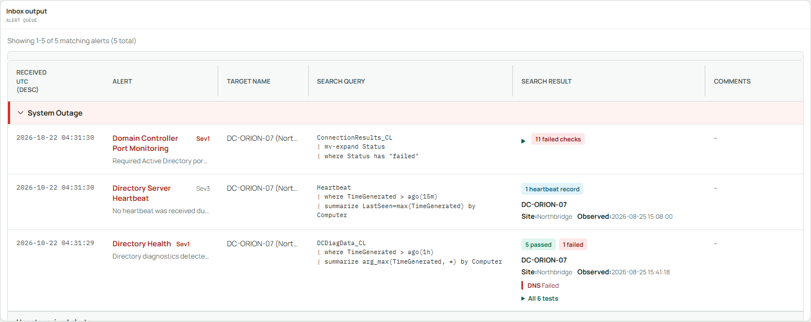

## Infrastruktur // Folge dem Datenpfad

Welche Systeme gehören zusammen? Wo häufen sich die Meldungen? Der Infrastrukturgraph macht aus einzelnen Alarmen ein verständliches Gesamtbild. Seine Ebenen lassen sich beispielsweise nach Umgebung, Standort und System ausrichten. Damit wird schneller sichtbar, ob nur ein einzelner Computer auffällt oder sich eine Störung durch einen ganzen Bereich zieht.

Die Standortkarte ergänzt die geografische Orientierung. Hinweise auf veraltete Statusmeldungen, auffällige Dienste und Wartungszustände helfen dabei, die Lage einzuordnen, statt jede Warnfarbe gleich zu interpretieren.

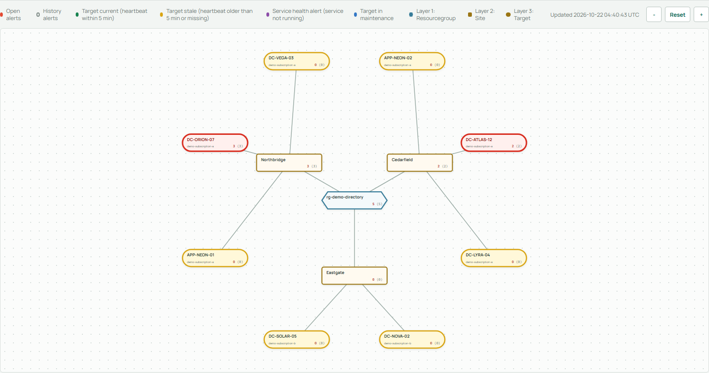

### Computer Inventory // Die Lagekarte sauber halten

Automatisch gemeldete Systemangaben sind nicht immer vollständig. Das Inventar ergänzt sie um gepflegte Informationen zu Standort, Domain und Aufgabe eines Computers. Die Crew kann Einträge suchen, filtern und korrigieren, statt dauerhaft mit unklaren oder veralteten Zuordnungen zu arbeiten.

Diese Angaben kommen auch dem Graphen und der Systemauswahl für Analysen zugute. Aus einem wenig aussagekräftigen Computernamen wird so ein einzuordnender Teil der Infrastruktur.

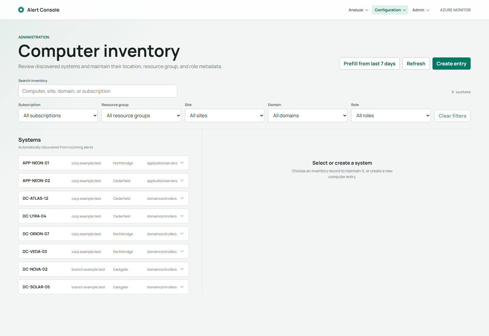

## Dashboards // Hinter das ICE schauen

Ein Alarm ist der Einstieg, nicht die ganze Story. Die neuen Dashboards legen freigegebene KQL-Auswertungen nebeneinander: Systemzustand, AD-Signale und zeitliche Auffälligkeiten im selben Blickfeld. Hilfreich, wenn die Crew nach Spuren aktiver Decker sucht – was tatsächlich sichtbar wird, bestimmen Datenquellen und Abfragen, nicht die Neonfarbe.

Workspace und Domäne schalten den relevanten Sektor für systembezogene Widgets auf. Eigene Domänen-Displaynamen halten auch geteilte Workspaces übersichtlich. Workspaceweite Widgets bleiben bewusst auf allen Workspaces der ausgewählten Systeme aktiv; sie ignorieren diese Anzeigefilter.

### Die passende Sicht // Nicht alles ist eine Tabellenzeile

Tabellen für Details, Waben für Zustände, Linien für Zeitspuren, Balken und Gauges für Größenverhältnisse. Kennzahlen und Statusverläufe ergänzen das Lagebild. Farben und Beschriftungen dienen dem Signal, nicht der Lichtshow.

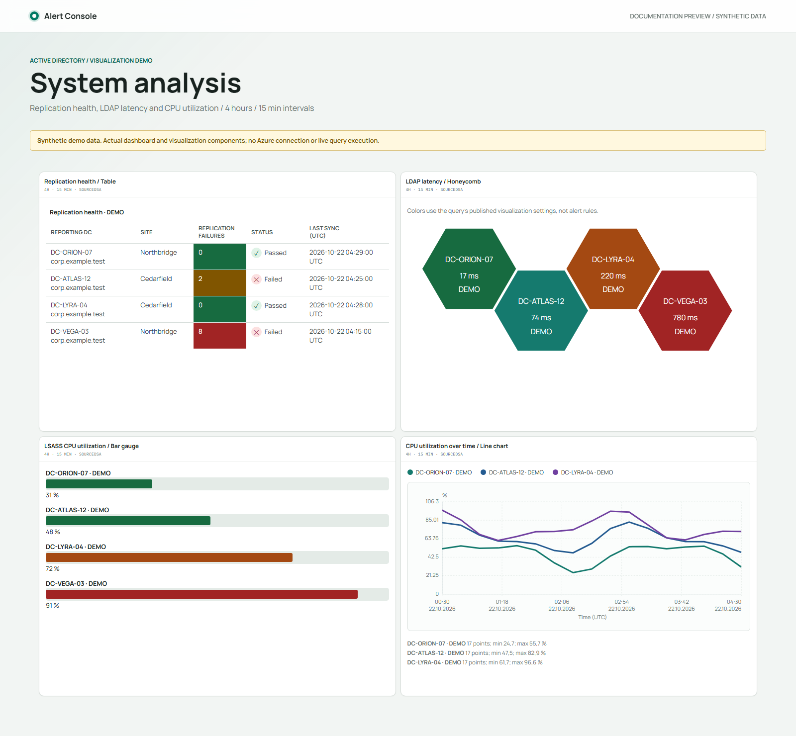

### Dashboards // Das persönliche Cockpit

Widgets aus der Bibliothek ziehen, verschieben und skalieren. Mehrere Cockpits speichern, Zeiträume und Mittelungsintervalle gemeinsam setzen, alle 30 Sekunden aktualisieren und Layoutänderungen rückgängig machen.

Admins veröffentlichen ihre Cockpits für die Crew. Private Umbauten bleiben privat, bis eine neue Version freigegeben wird. Kein Überraschungsumbau mitten im Run.

## Query Library // Ordnung im Datenarsenal

Die Abfragenbibliothek hält wiederverwendbare Auswertungen bereit. Kategorien und Unterkategorien sorgen dafür, dass auch ein größerer Werkzeugkasten übersichtlich bleibt. Statt eine lange Liste zu durchsuchen, kann die Crew beispielsweise direkt zu Replikation, Leistung oder Sicherheit wechseln.

Die mitgelieferte **Active-Directory-Bibliothek mit 38 Vorlagen** bietet einen Ausgangspunkt für typische Untersuchungen. Sie deckt unter anderem Systemzustand, Replikation, Leistung und Sicherheit ab und enthält auch Übersichten zu wichtigen Verzeichnisrollen und Gruppenrichtlinien.

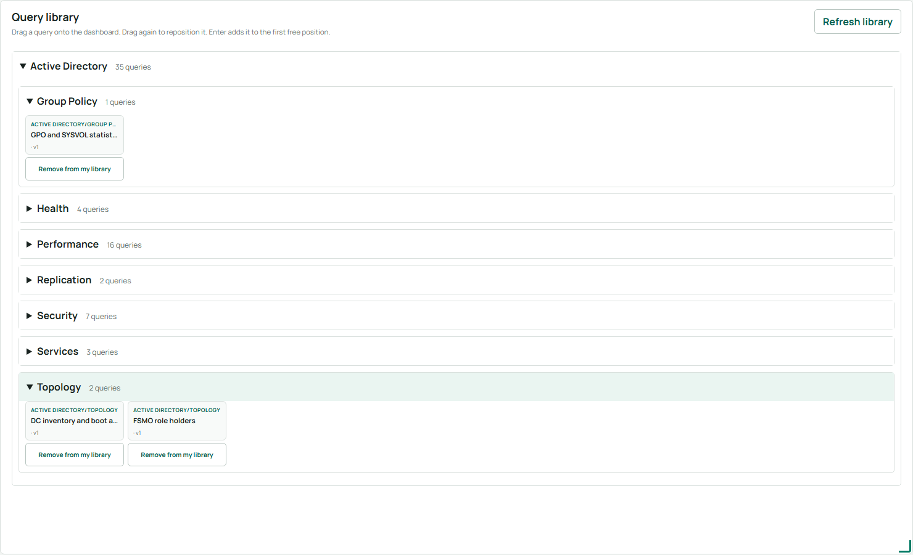

### Query Registry // Den Werkzeugkasten pflegen

Admins verwalten die Abfragen und ihre Darstellung an einer zentralen Stelle. Neue oder geänderte Auswertungen werden geprüft, bevor sie für die Crew freigegeben werden. Ein unfertiger Arbeitsstand ersetzt damit nicht versehentlich das Werkzeug, das andere gerade im Einsatz haben.

Kategorien lassen sich anlegen, umbenennen und neu ordnen. Abfragen können per Ziehen oder über eine Auswahl zugeordnet werden. Die Gliederung erscheint auch in der Bibliothek; zum bloßen Aufräumen müssen die Auswertungen nicht neu veröffentlicht werden.

Eigene Anpassungen bleiben beim erneuten Installieren der mitgelieferten Bibliothek erhalten. Gespeicherte Abfragen lassen sich zusammen mit ihren Ansichten exportieren, um sie weiterzuverwenden. Das nimmt den Werkzeugkasten mit, ersetzt aber keine vollständige Sicherung der Anwendung.

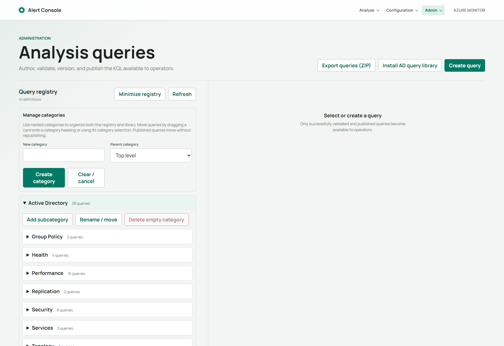

## Regelwerk // ICE gegen das Rauschen

Nicht jede Meldung braucht dieselbe Aufmerksamkeit. Regeln helfen dabei, bekannte Situationen einzuordnen, unauffällige Ergebnisse zurückzunehmen und kritische Störungen hervorzuheben. So bleiben wichtige Signale sichtbar, auch wenn viele ähnliche Meldungen eintreffen.

Beispielsweise kann ein einzelner bekannter Prüffehler anders behandelt werden als mehrere gleichzeitig fehlgeschlagene Prüfungen. Regeln können außerdem dabei helfen, die Aufgabe eines erkannten Systems im Inventar zuzuordnen. Die Bewertung bleibt zentral pflegbar, statt sich auf persönliche Gewohnheiten einzelner Operatoren zu verlassen.

## Logbook // Das Gedächtnis der Crew

Das Logbuch hält Beobachtungen und wichtige Systemereignisse fest. Manuelle Notizen werden mit Benutzer und Zeitpunkt versehen; auch neue oder geänderte Kommentare an Meldungen finden hier ihren Platz.

Zusätzlich dokumentiert die Console, wenn kritische Störungen beginnen oder behoben werden. So weiß auch die nächste Schicht, was passiert ist und was bereits untersucht wurde. Keine Einsatzgeschichte, die nur im Kopf eines einzelnen Deckers existiert.

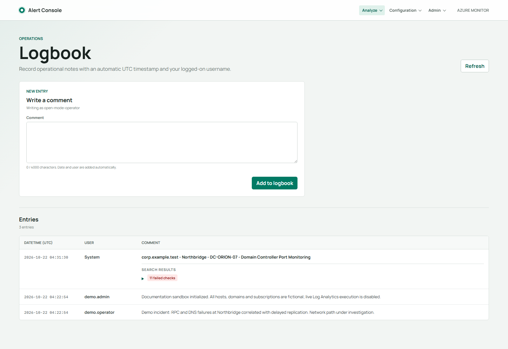

## Copilot Handoff // Mensch in der Schleife

Für die manuelle Übergabe an Copilot lassen sich ausgewählte Meldungen mit ihrem Zusammenhang zu einer Analysevorlage zusammenstellen. Dazu gehören nicht nur die einzelnen Alarme, sondern auch passende Informationen aus Systemhistorie, Inventar, Graph und Regelbewertung.

Zeitraum und Auswahl bestimmen, welcher Ausschnitt der Lage vorbereitet wird. Die Crew kann den Inhalt vor der Übergabe prüfen und entscheidet bewusst, was sie weitergibt. Das spart das wiederholte Zusammensuchen derselben Informationen, ohne die fachliche Bewertung aus der Hand zu geben.

Ein Agent ist ein Werkzeug, kein Johnson, dem man blind vertraut.

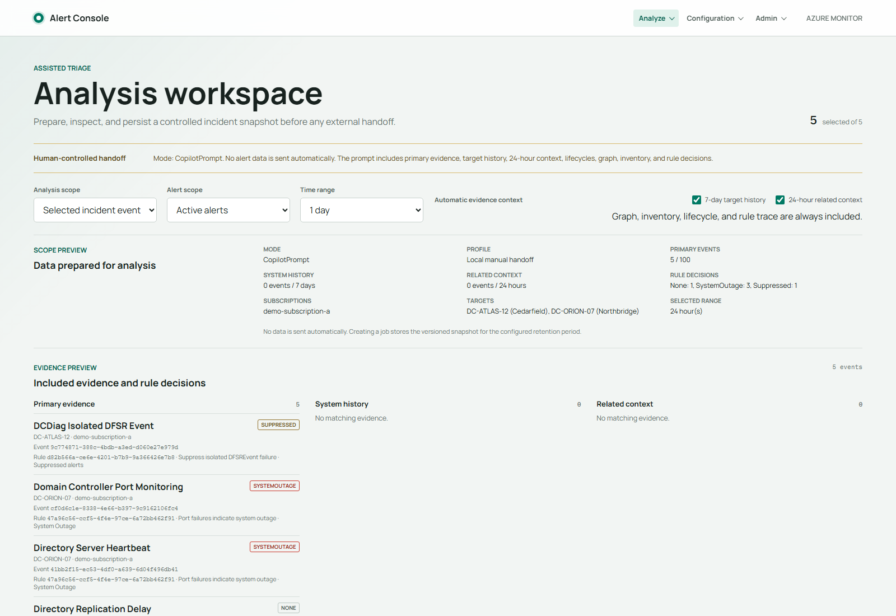

## Zugriff und Verwaltung // Wards vor dem Host

Nicht jedes Crewmitglied braucht dieselben Werkzeuge. Die Rollen teilen den Zugriff nach Aufgabe auf:

| Rolle | Aufgabe |
| --- | --- |
| **Reader** | Die Lage verfolgen, Ereignisse nachlesen und Beobachtungen festhalten. |
| **Operator** | Zusätzlich Systeme und Regeln pflegen sowie freigegebene Analysen nutzen. |
| **Admin** | Zusätzlich Benutzer, Einstellungen und Abfragen verwalten sowie eigene Dashboards veröffentlichen. |

Darstellung, Anzeigezeiträume und weitere Einstellungen werden zentral verwaltet. Die Crew bekommt Orientierung, ohne dass jeder an allen Schaltern drehen muss.

Die Zugriffsgrenzen gelten nicht nur für sichtbare Menüpunkte, sondern auch für die dahinterliegenden Funktionen. Für den produktiven Einsatz gehören persönliche Zugänge und bewusst vergebene Rechte zum Grundschutz des Nodes.

## Zusammenspiel // Vom Sensor zur Untersuchung

Azure Monitor liefert die Meldungen. Die Console ordnet sie ein, verbindet sie mit den bekannten Systemen und stellt sie in Inbox, Verlauf und Graph dar. Von dort kann die Crew eine weiterführende Analyse beginnen und ihre Erkenntnisse im Logbuch festhalten.

Für ergänzende Werkzeuge stehen auch lesende Zugriffsmöglichkeiten auf aktuelle Meldungen und die Ereignishistorie bereit. Die Console kann damit Teil eines bestehenden Betriebsablaufs sein, statt die Crew in eine weitere isolierte Insel zu schicken.

Ein typischer Run: Mehrere Meldungen treffen an einem Standort ein. In der Inbox fällt die Häufung auf, der Graph zeigt die betroffenen Systeme, und eine vorbereitete Analyse hilft beim Vergleich ihrer Zustände. Die Untersuchung und ihre Ergebnisse bleiben für die nächste Schicht dokumentiert.

## Weitere Einblicke // Rundgang durch den Node

<details>
<summary>Weitere Screenshots aufklappen</summary>

### Inbox und Standortkarte

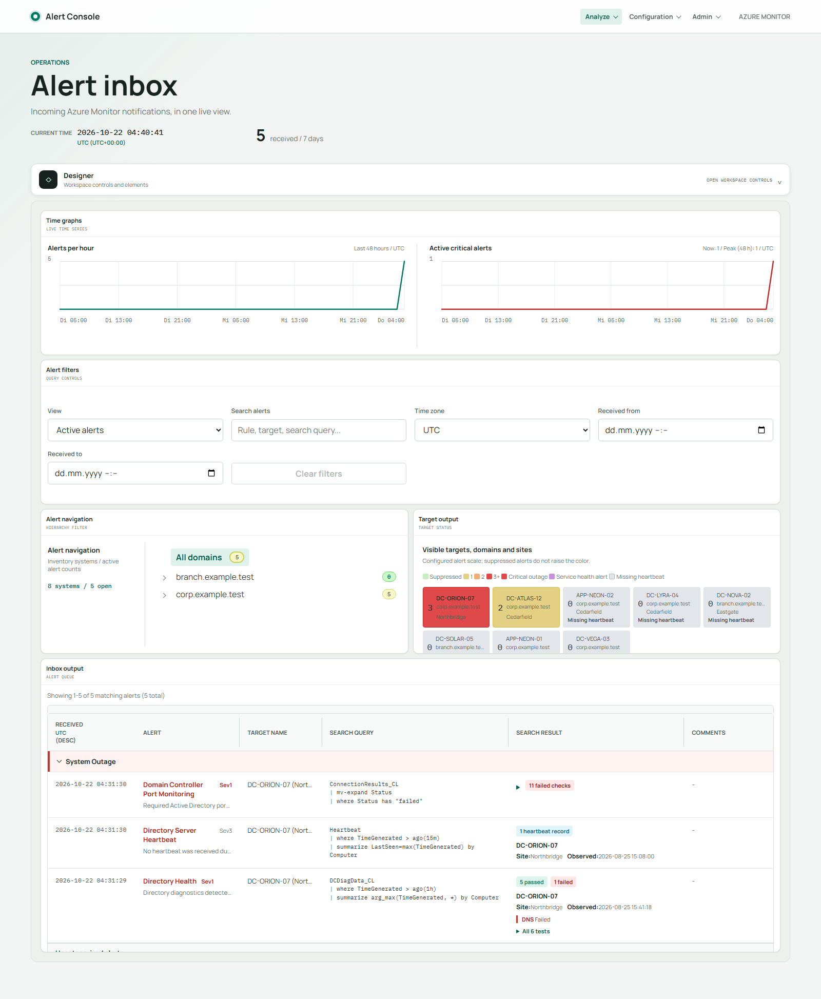

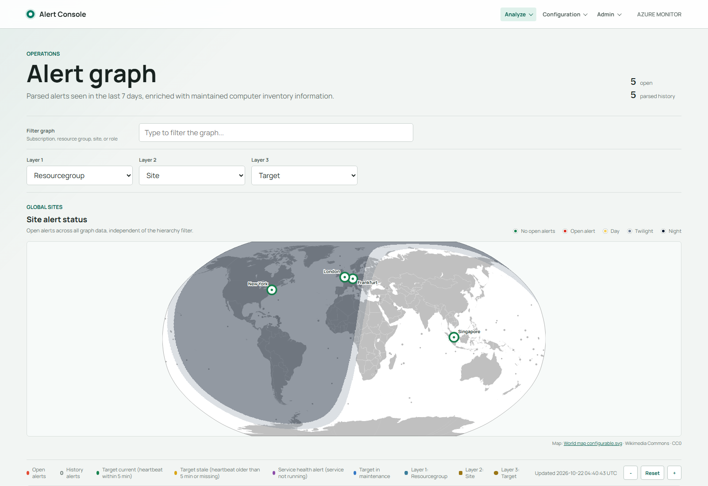

### Analyseverwaltung

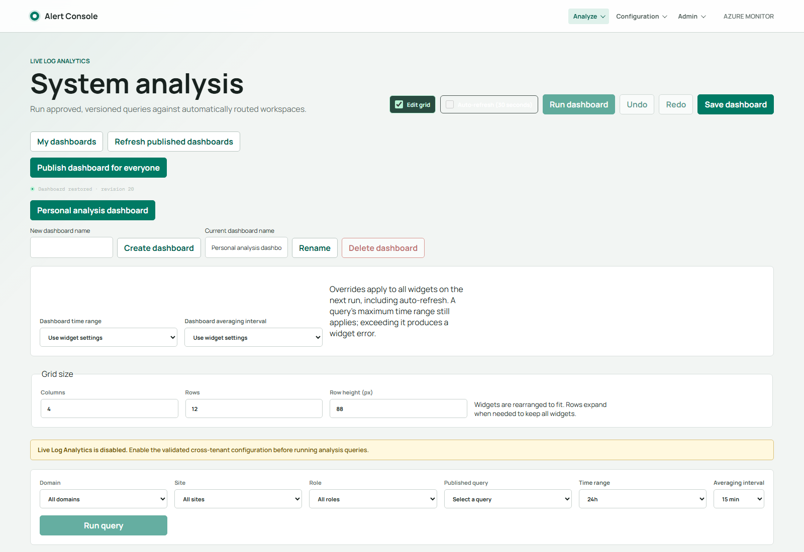

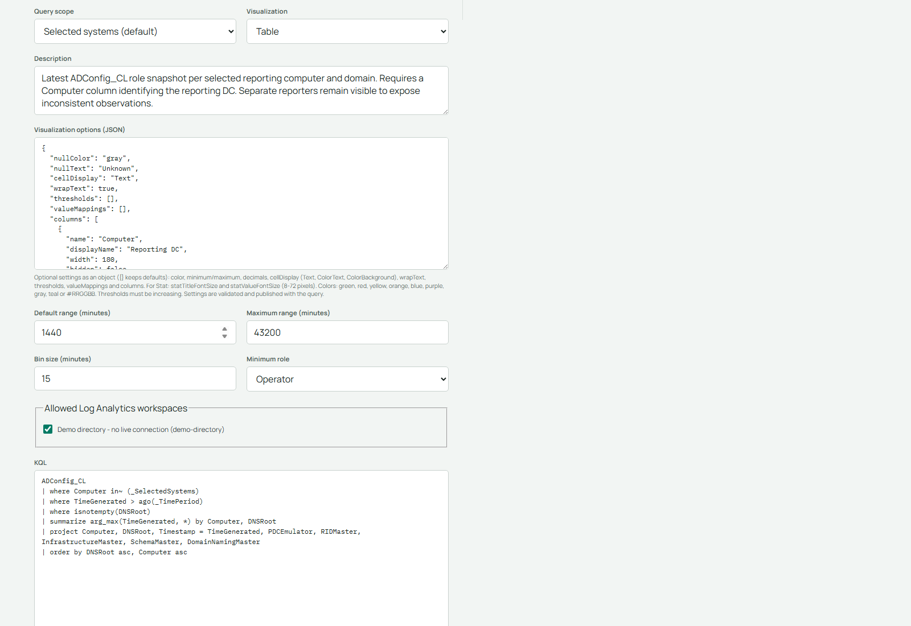

### Regeln, Benutzer und Einstellungen

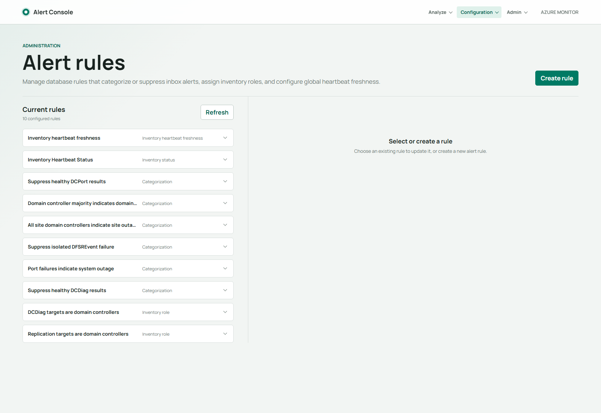

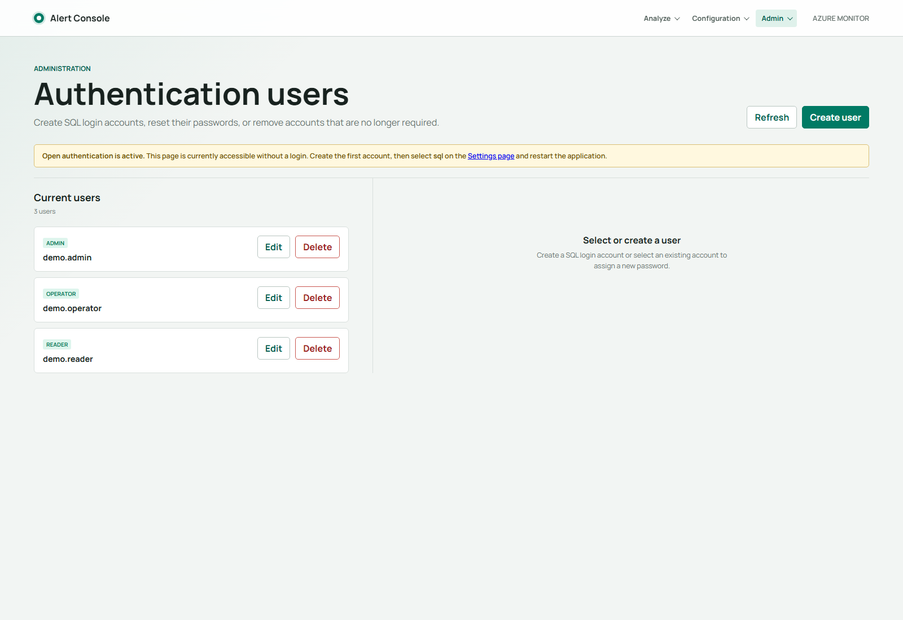

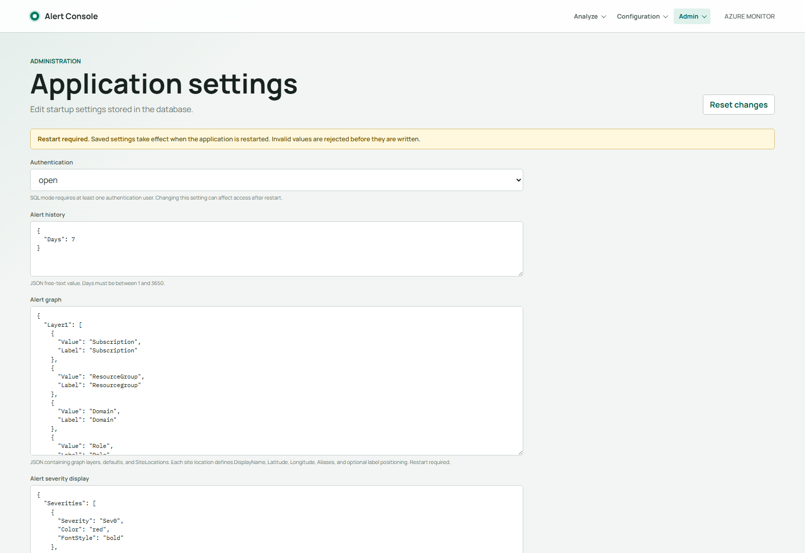

### Anbindung weiterer Werkzeuge

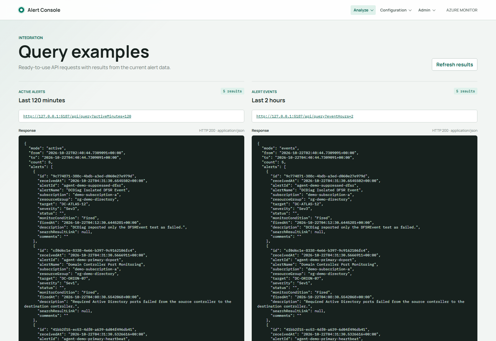

</details>

## Vor dem Run // Weiterführende Informationen

Diese Seite gibt den Überblick. Einrichtung, Betrieb und technische Details stehen in der [technischen Dokumentation](./MonitoringApp/README.md). Eine Übersicht der verwendeten externen Komponenten bietet das [Abhängigkeitsverzeichnis](./THIRD-PARTY-DEPENDENCIES.md).

Für den echten Einsatz gilt: Zugriffe bewusst vergeben, vertrauliche Daten schützen und Backups prüfen. Das Trainingsgelände ist nicht das Produktionsnetz.

## Schlusswort // Bleib wachsam

Die Console hilft der Crew, zwischen Matrixrauschen und echtem Infrastrukturbrand zu unterscheiden. Halte die Lagekarte sauber, das Logbuch ehrlich und den Blick auf das Wesentliche.

Und wenn ein freundlicher Auftraggeber mit goldenen Augen darum bittet, die Einsatzhistorie „nur ganz kurz“ verschwinden zu lassen: Verbindung trennen, Credstick einpacken und laufen.

**Vorsicht vor Drachen.**
