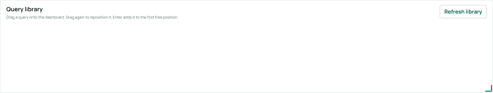
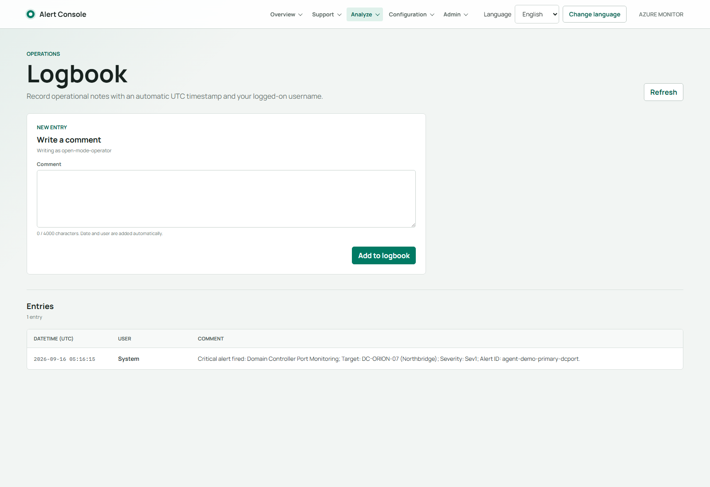
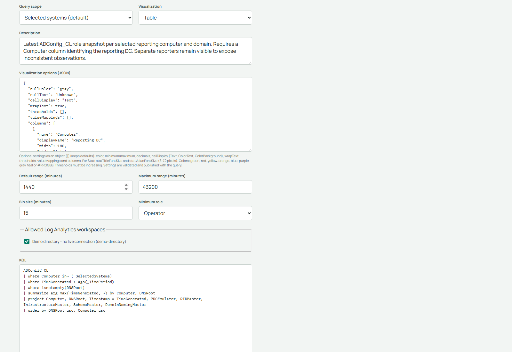
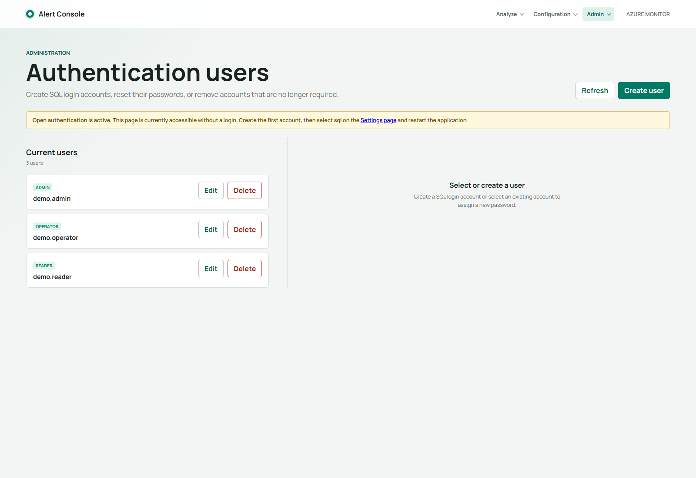
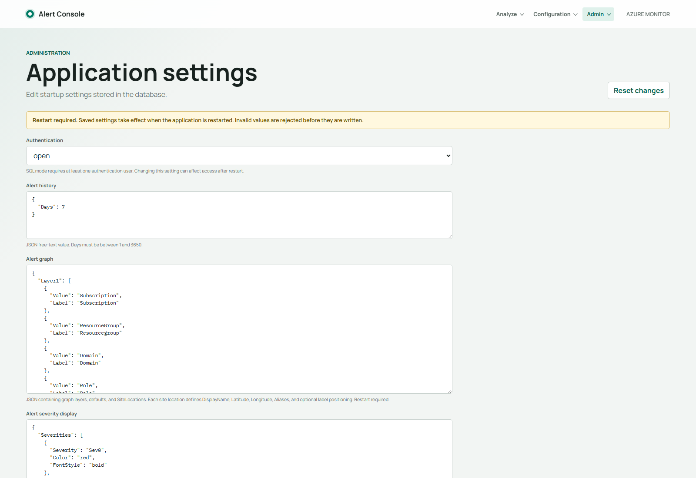
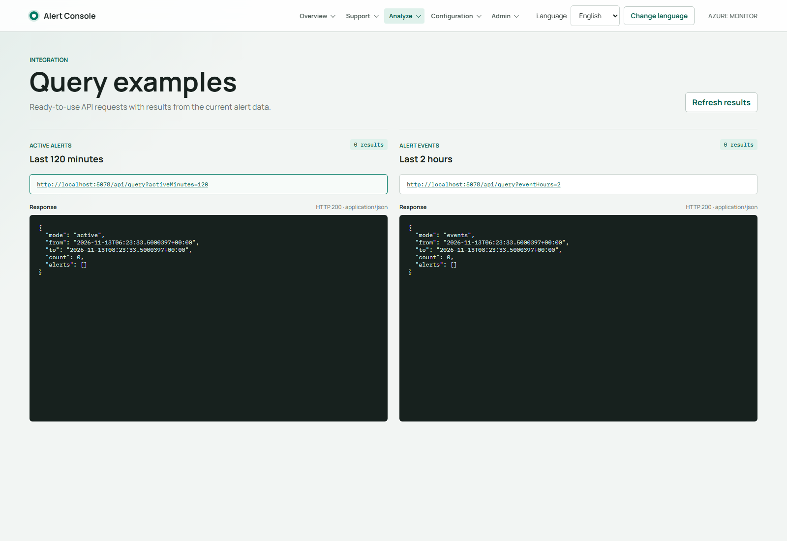

# Azure Monitoring Console // Matrix Operations Node

Willkommen im Grid, Chummer.

Mehrere Tenants. Flackernde Warnlampen. Irgendwo im Datenstrom hinterlässt ein aktiver Decker seine Spuren.

Die **Azure Monitoring Console** bringt Azure-Monitor-Meldungen, Inventar und Log-Analytics-Auswertungen in einen gemeinsamen Node. **Multi-Tenant-Monitoring statt Portalslalom. Dashboards statt Blindflug hinter dem ICE.** Die Crew sieht, wo Systeme ausfallen, Signale zusammenlaufen und sich ein genauerer Blick lohnt.

> **Straßenregel Nr. 1:** Nicht jedes Signal ist ein Infrastrukturbrand.
>
> **Straßenregel Nr. 2:** Halte die Crew auf demselben Stand.
>
> **Straßenregel Nr. 3:** Mach niemals einen Deal mit einem Drachen.

## Was im Node verdrahtet ist

Unter der Chromhaube läuft eine **ASP.NET Core Blazor WebApp auf .NET 10** mit **SQL Server oder Azure SQL** als Datenspeicher. Azure Monitor und Logic Apps liefern die Meldungen; die Console verbindet sie mit Inventar, Regeln und Analyse.

- **Multi-Tenant-Monitoring // Ein Node, mehrere Konzernnetze:** Meldungen zentral verfolgen und Log-Analytics-Abfragen automatisch zum passenden Workspace routen.
- **Dashboards // Aktiven Deckern auf der Spur:** Persönliche Cockpits aus freigegebenen KQL-Abfragen bauen, Zeiträume vergleichen, automatisch aktualisieren und für die Crew veröffentlichen. Auffälligkeiten untersuchen statt im Lograuschen stochern.
- **Stillgelegte Systeme:** Persönliche und veröffentlichte Dashboards überspringen nicht mehr im Inventory vorhandene Systeme mit sichtbarem Hinweis. Die gespeicherte Auswahl bleibt erhalten; fehlen alle Systeme, wird keine Abfrage ausgeführt.
- **Workspace- und Domänenwechsel // Den richtigen Sektor aufschalten:** Systembezogene Widgets nach Workspace, Domäne, Standort und Rolle filtern, ohne die gespeicherte Systemauswahl anzutasten.
- **Alert Inbox und Timelines // Das Frühwarnradar:** Aktive Meldungen, Ereignishistorie und zwei 48-Stunden-Verläufe mit Filtern, Severity-Farben und flexiblem Raster.
- **Graph und Inventar // Die Karte hinter dem ICE:** Systeme, Domänen, Standorte und Rollen in Topologie, Standortkarte und gepflegtem Inventar verbinden.
- **Regelwerk // Weniger Rauschen, mehr Signal:** Meldungen kategorisieren, bekannte Situationen unterdrücken, kritische Störungen hervorheben und eigene KQL-Prüfungen zeitgesteuert auswerten.
- **Unbekannte Replikationsziele:** Unter Scheduled KQL queries die JSON-Vorlage „Unbekannte Replikationsziele im Inventory“ öffnen, Workspaces auswählen, testen und aktivieren. Der Bereich **Unbekannte Inventory-Ziele** prüft `DCReplicationData_CL.DestDSA` alle fünf Minuten gegen das vollständige aktuelle Workspace-Inventory (auch Wartungssysteme), mit fünf Minuten Fenster und zwei Minuten Ingestion-Verzögerung. Die Query endet mit `where Target !in~ (_InventoryComputers) | summarize count() by Target`: je unbekanntem Ziel ein eigener Sev2-Alert mit dessen Beobachtungszahl, keine künstlichen Event-/Benutzerspalten. Ein erfolgreiches vollständiges Ergebnis ohne dieses Ziel oder seine Aufnahme ins Inventory löst seine Episode auf; Abfragefehler und unvollständige Ergebnisse nicht. Ohne Inventory-Basis erfolgt ein Prüffehler statt einer Massenwarnung. Vorhandene gespeicherte Queries bleiben unverändert: die neue Vorlage als neue Regel anlegen und die alte workspaceweite Regel kontrolliert deaktivieren; Bereichswechsel sind nur bei deaktivierten Regeln ohne aktive Alerts möglich. Dafür ist keine zusätzliche SQL-Schemaänderung nötig. Die alte Ableitung aus eingehenden Replikationsalerts entfällt; historische Alerts bleiben erhalten. Für vorhandene Datenbanken deaktiviert [UpgradeRetireReplicationInventoryWarning.sql](MonitoringApp/Services/EFCore/Scripts/UpgradeRetireReplicationInventoryWarning.sql) ausschließlich die alte Eingangsregel; der Block ist auch in SECTION 2 des Installationsskripts enthalten. Keine automatische Aktivierung der neuen Scheduled-Regel.
- **Wartung:** App-Reset und [SQL-Reset](MonitoringApp/Services/EFCore/Scripts/ResetMonitoringData.sql) stellen dieselben zehn Standardregeln wieder her, ohne die stillgelegte Replikationswarnung. Eine erneute Installation nach deren Retirement legt sie ebenfalls nicht wieder an. Das Reset-Skript löscht Betriebsdaten und ist **kein Upgrade-Skript**; diese Korrektur benötigt keine neue Schema-Migration.
- **Query Library // Das Datenarsenal:** 39 AD-Vorlagen, versionierte Abfragefreigaben, verschachtelte Kategorien, Drag & Drop und ZIP-Export.
- **Visualisierungen // Mehr als Neon:** Tabellen, Linien, Balken, Waben, Gauges, Kennzahlen und Statusverläufe mit anpassbaren Farben und Beschriftungen.
- **RCA und Logbuch // Keine Spur geht verloren:** Gemeinsame Untersuchungsfälle, Zuständigkeit, Status, Kommentare und Einsatzhistorie; gespeicherte RCA-Prompts zur manuellen Analyse.
- **Copilot Handoff // Mensch am Deck:** Kontext für eine bewusste, manuelle Übergabe vorbereiten. Keine automatische Jagd, kein autonomer Decker-Detektor.
- **Zugriff und Betrieb // Wards am Eingang:** Reader-, Operator- und Admin-Rechte, zentrale Einstellungen, REST-Schnittstellen, CLI und optionales Azure-Monitor-Anwendungsmonitoring.

## Das Cockpit // Was die Crew bekommt

Unter **Overview** stehen **Inbox**, **Graph** und **Dashboards** bereit. **Analyze** führt zu Queries, Logbook, Root Cause Analysis und Analysis Workspace. Inventar und Regeln ergänzen die Arbeit; unter **Admin** liegen Benutzerverwaltung, Einstellungen und Abfrageverwaltung.

Im laufenden Betrieb beginnt der Blick meist in der **Inbox**: Welche Meldungen sind neu, welche Störungen noch aktiv und wo steigt der Druck? Der **Infrastrukturgraph** ergänzt die Zusammenhänge zwischen Systemen und Standorten. Das **Inventar** liefert die gepflegten Angaben zu den betroffenen Computern.

Für die Untersuchung geht es weiter zu den **Dashboards** und **RCA-Fällen**. Freigegebene Auswertungen, persönliche Cockpits und gemeinsame Untersuchungen helfen dabei, aus einzelnen Signalen ein Lagebild zu machen. **Regeln und Logbuch** halten der Crew den Rücken frei: Bekanntes Rauschen lässt sich einordnen, wichtige Ereignisse werden hervorgehoben und Erkenntnisse bleiben für die nächste Schicht erhalten.

*Die Screenshots zeigen die lokale Anwendung mit fiktiven Demodaten. Das Dashboard ist ausdrücklich als synthetisches Beispiel gekennzeichnet und zeigt keine live abgefragten Azure-Daten.*

## Alert Inbox // Jack in

Die Inbox ist der erste Blick auf die Lage. Sie zeigt aktuelle Störungen ebenso wie vergangene Ereignisse. Filter nach Zeitraum, betroffenem System und Umgebung helfen dabei, aus vielen Meldungen genau den Ausschnitt herauszuholen, der für die Untersuchung zählt.

Kategorien und farbliche Hervorhebungen machen Prioritäten erkennbar. Zwei Zeitverläufe zeigen, wann Meldungen ausgelöst wurden und wie viele kritische Störungen gleichzeitig aktiv waren. Wird eine Störung später behoben, bleibt ihr vorheriger Verlauf nachvollziehbar. Eine grüne Lampe im Jetzt löscht schließlich nicht den Brand von vorhin.

Prüfergebnisse werden direkt an der Meldung lesbar aufbereitet. So lässt sich beispielsweise erkennen, welche Verbindungstests fehlgeschlagen sind, ohne dafür durch mehrere Ansichten springen zu müssen. Eigene Kommentare halten fest, was bereits geprüft wurde. Hinweise auf offene RCA-Fälle verbinden die aktuelle Meldung mit der gemeinsamen Untersuchung.

Auch das Cockpit selbst ist anpassbar: Filter, Zeitverläufe und Ergebnisbereiche lassen sich nach dem eigenen Arbeitsstil anordnen und in ihrer Größe verändern.


## Infrastrukturgraph // Folge dem Datenpfad

Welche Systeme gehören zusammen? Wo häufen sich die Meldungen? Der Infrastrukturgraph macht aus einzelnen Alarmen ein verständliches Gesamtbild. Seine Ebenen lassen sich beispielsweise nach Umgebung, Standort und System ausrichten. Damit wird schneller sichtbar, ob nur ein einzelner Computer auffällt oder sich eine Störung durch einen ganzen Bereich zieht.

Die Standortkarte ergänzt die geografische Orientierung. Hinweise auf veraltete Statusmeldungen, auffällige Dienste und Wartungszustände helfen dabei, die Lage einzuordnen, statt jede Warnfarbe gleich zu interpretieren.


### Computer Inventory // Die Lagekarte sauber halten

Automatisch gemeldete Systemangaben sind nicht immer vollständig. Das Inventar ergänzt sie um gepflegte Informationen zu Standort, Domäne und Aufgabe eines Computers. Die Crew kann Einträge suchen, filtern und korrigieren, statt dauerhaft mit unklaren oder veralteten Zuordnungen zu arbeiten.

Diese Angaben kommen auch dem Graphen und der Systemauswahl für Analysen zugute. Aus einem wenig aussagekräftigen Computernamen wird so ein einzuordnender Teil der Infrastruktur.


### Optionaler Teamfilter im Computer Inventory

Mit `IdentityDirectory.Enabled=true` bietet das Computer Inventory eine manuelle
Mehrfachauswahl aller aktiven Teams, auch im Open-Modus. Die zugeordneten
Inventory-Serverrollen werden vereinigt (ODER); vorhandene Such- und Feldfilter
grenzen das Ergebnis zusätzlich ein. Ohne Teamauswahl bleibt die bisherige Ansicht
erhalten. Ausgewählte Teams ohne Rollen liefern keine Treffer; rollenlose Server
erscheinen nur ohne Teamfilter. Deaktivierte oder gelöschte ausgewählte Teams bleiben
als nicht verfügbar sichtbar und tragen keine Rollen bei, statt den Filter
unbemerkt aufzuheben. Aktualisieren übernimmt aktuelle Teams, Zuordnungen und
Inventory-Rollen.

Die Auswahl gilt nur für die aktuelle Inventory-Seite, wird nicht gespeichert und
ändert keine Zugriffsrechte. Es gibt keine automatische Auswahl anhand einer
Benutzeridentität und keine Teamfilterung in Inbox, Graph oder Dashboards.
Das bestehende [AP9-SQL-Upgrade](MonitoringApp/Services/EFCore/Scripts/UpgradeOpenAdministrationAndTeamInventoryRoles.sql)
muss bei aktiviertem Verzeichnis bereits angewendet sein; dieser Filter benötigt
keine zusätzliche Migration.

## Dashboards // Hinter das ICE schauen

Ein Alarm ist der Einstieg, nicht die ganze Story. Die Dashboards legen freigegebene KQL-Auswertungen nebeneinander: Systemzustand, AD-Signale und zeitliche Auffälligkeiten im selben Blickfeld. Hilfreich, wenn die Crew nach Spuren aktiver Decker sucht – was tatsächlich sichtbar wird, bestimmen Datenquellen und Abfragen, nicht die Neonfarbe.

Ein gemeinsamer Filterbereich mit Workspace, Domäne, Standort und Rolle grenzt die Systemauswahl und systembezogene Widgets ein. Bereits ausgewählte Systeme bleiben gespeichert und werden für die aktuelle Anzeige nur eingegrenzt. Eigene Anzeigenamen halten auch geteilte Workspaces übersichtlich. Workspaceweite Auswertungen liefern dagegen bewusst den breiteren Blick auf die beteiligten Workspaces.

### Die passende Sicht // Nicht alles ist eine Tabellenzeile

Tabellen für Details, Waben für Zustände, Linien für Zeitspuren, Balken und Gauges für Größenverhältnisse. Kennzahlen und Statusverläufe ergänzen das Lagebild. Farben und Beschriftungen dienen dem Signal, nicht der Lichtshow.

Liniencharts halten den Verlauf im Vordergrund; ihre Legende ist bei Bedarf per Maus oder Tastatur erreichbar. Waben passen sich der verfügbaren Widgetfläche an und lassen sich für einen genaueren Blick vergrößern. Wo es auf einzelne Werte ankommt, ergänzt die Tabellenansicht die grafische Darstellung.


### Das persönliche Cockpit // Umbauen, ohne die Crew zu überraschen

Widgets aus der Bibliothek ziehen, verschieben und skalieren. Mehrere Cockpits speichern, Zeiträume und Mittelungsintervalle gemeinsam setzen, automatisch aktualisieren und Layoutänderungen rückgängig machen. Im kompakten Modus steht die Auswertung im Mittelpunkt; **Edit** öffnet die Werkzeuge zum Umbau.

Beim Aktualisieren werden die Widgets nacheinander geladen. Bisherige Inhalte bleiben bis zur jeweiligen Aktualisierung sichtbar; ein Fehler in einer Abfrage stoppt nicht das ganze Cockpit. Fehlende Daten und Abfragefehler werden kenntlich gemacht, statt eine falsche Entwarnung vorzutäuschen.

Admins veröffentlichen ihre Cockpits für die Crew. Private Umbauten bleiben privat, bis eine neue Version freigegeben wird. Veröffentlichte Dashboards lassen sich ansehen und als Ausgangspunkt für eigene Cockpits verwenden. Kein Überraschungsumbau mitten im Run.

Unter **Overview / Übersicht → Dashboards** sind veröffentlichte Dashboards für
Operatoren und Admins direkt als dritte Menüebene auswählbar. Der Direktaufruf
zeigt nur die Workspace-Auswahl und die Widgets, ohne Ersteller, Versions- oder
Systemliste und ohne Bearbeitungs- und Ausführungsleisten. Automatischer Start,
die gespeicherte Auto-Refresh-Einstellung und Fehlerhinweise bleiben erhalten.
Die Einträge werden beim Laden einer Seite aus den aktuellen Veröffentlichungen
gelesen; zurückgezogene Dashboards sind auch über alte Direktlinks nicht mehr
abrufbar. **My dashboards / Meine Dashboards** öffnet weiterhin unverändert die
bisherige Dashboard-Seite mit ihrer Verwaltung und Detailansicht.

### KQL-Editoren // Hilfe beim Tippen

Freie KQL-Abfragen, Analysis-Abfragedefinitionen und geplante Abfragen verwenden
dieselbe [KqlEditor-Komponente](./MonitoringApp/Components/KQL/KqlEditor.razor).
Die Beispiele im freien KQL-Editor sind standardmäßig eingeklappt und lassen
sich über die Überschrift mit Maus oder Tastatur öffnen.
Sie ergänzt Schlüsselwörter und Funktionsnamen lokal im Browser. Bei genau einem Präfixtreffer erscheint der
fehlende Rest am Zeilenende grau: **Tab** übernimmt, **Escape** blendet aus,
**Enter** bleibt ein Zeilenumbruch. Ohne Vorschlag bleiben Tab und Shift+Tab die
normale Fokusnavigation. In Kommentaren, Zeichenketten und markiertem Text
erscheinen keine Vorschläge. Erst die Übernahme verändert den Abfragetext.
Tab-Übernahmen sind ein eigener Schritt in der nativen Undo-/Redo-Historie
des Textfelds. Auch gequotete Namen lassen sich mit den browserüblichen
Rückgängig-/Wiederholen-Befehlen zurücknehmen und wiederherstellen.
Unterstützt ein Browser die native Übernahme nicht, erscheint ein Fehlerhinweis;
normales Bearbeiten und die Fokusnavigation bleiben verfügbar.

Vollständige Schlüsselwörter und Funktionsnamen aus dem Wörterbuch erscheinen
im gesamten Editor grün, auch ohne Fokus. Unbekannte oder unvollständige Wörter,
Zeichenketten und Kommentare bleiben normal; Ergänzungsvorschläge bleiben grau.
Die Einfärbung ist eine Wörterbucherkennung, keine semantische KQL-Prüfung.
Cursor, Auswahl und Kopieren arbeiten weiterhin mit dem unveränderten Textfeld.
Bei einem Ladefehler bleibt dessen normale Textdarstellung erhalten.

Die ausklappbare **KQL-Schlüsselworthilfe / KQL keyword reference** listet alle
Schlüsselwörter und Funktionen aus dem JSON-Wörterbuch alphabetisch auf,
einschließlich verschachtelter `next`-Einträge. Mouseover, Tastaturfokus oder
Antippen zeigt die hinterlegte Hilfe in der gewählten Sprache; fehlt eine
Beschreibung, wird das ausdrücklich angezeigt. Pfeiltasten, Pos1 und Ende
navigieren, Escape schließt die Liste. Die Hilfe dient nur zum Nachschlagen
und verändert weder Abfragetext noch Undo-/Redo-Historie.

Bei genau einem Workspace berücksichtigt die Spaltenhilfe jetzt auch `join`
und `union`, einschließlich geklammerter Unterabfragen, lokaler `let`-Bindungen
und `materialize`. Join-Schlüssel lassen sich über gemeinsame Spaltennamen
oder `$left.Spalte == $right.Spalte` vervollständigen. Join-Art und tatsächliche
Namenskollisionen bestimmen die nachfolgenden Spalten; Semi-/Anti-Joins liefern
nur die entsprechende Seite. `union` unterstützt Quellen- und Pipe-Schreibweise,
`kind=outer`/`kind=inner` und `withsource`, einschließlich Typsuffixen wie
`Value_long`/`Value_int`. Die Operatorhilfe bleibt im JSON-Wörterbuch.

Das ist eine konservative erste AP8-Stufe: Bei Typkonflikten in `union kind=inner`
oder unbekannten abgeleiteten Typen bleibt das Schema ausdrücklich unvollständig,
statt Spalten zu erraten. Fehlende, fehlerhafte oder veraltete Quellschemas werden
nicht zu einem vollständigen Ergebnis kombiniert. Über 1024 abgeleitete Spalten,
Join-/Union-Hints, fuzzy/wildcard/dynamische Quellen und benutzerdefinierte
Funktionen bleiben ohne bestätigte Schemaableitung. Workspaceübergreifende
Schemamischung bleibt ausgeschlossen. Bearbeiten, Run und Save werden dadurch
nicht gesperrt.

Unter dem Textfeld stehen **lokale Editorhinweise**: eindeutig unpassende
schließende Klammern, noch offene Entwurfseingaben und einfache unbekannte
Spaltenreferenzen bei sicher bekanntem Schema im aktiven Statement.
Ein Klick auf einen Hinweis markiert die betreffende Textstelle, ohne Text
zu ändern. Die Analyse ist begrenzt und keine vollständige Kusto-Prüfung.
Fehlende Schemadaten und unbekannte Funktionen gelten nicht als Syntaxfehler.
Run, Save und ihre bisherigen serverseitigen Regeln bleiben unverändert.
Es erscheinen höchstens zwölf Hinweise; Mehrfach-Workspace-Auswahl liefert
keine vermeintlich workspaceübergreifend bestätigten Spaltenfehler.

Beim Auswählen eines Workspaces lädt der Editor automatisch dessen Tabellennamen
mit der unveränderten Abfrage:

```kql
search *
| summarize count() by $table
| sort by $table
```

Im freien Editor gilt der ausgewählte Workspace, bei Analysis-Abfragen gelten
alle aktivierten Workspace-Zuordnungen, bei geplanten Abfragen alle ausgewählten
Workspaces. Mehrere Ergebnisse werden als Vereinigung zusammengeführt.
Unter der Workspace-Auswahl des freien Editors erscheinen die gefundenen
Tabellennamen und der KQL-Editor jeweils über die gesamte verfügbare Breite wie
die Ergebnisausgabe. Ausführen und Abbrechen stehen kompakt in einer eigenen
Aktionszeile unter dem Editor.
Die gefundenen Tabellennamen erscheinen als Liste mit Lade-, Leer- und Fehlerzustand. Die Liste
verwendet denselben Katalog wie die Vervollständigung und erzeugt keine zweite
Discovery-Abfrage. „Tabellen neu laden“ am Editor aktualisiert auch diese Liste.
Die Abfrage läuft ohne Zeitfilter über die vorhandenen Daten; leere Tabellen
ohne durchsuchbare Daten werden deshalb nicht entdeckt. Das kann abhängig vom
Datenvolumen Zeit und Azure-Abfragekosten verursachen und benötigt dieselben
Live-Konfigurationen und Leseberechtigungen wie freie KQL-Abfragen.
Pro tatsächlichem Auswahlwechsel wird jeder Workspace einmal abgefragt,
nicht bei jedem Tastendruck. Tabellennamen werden nur im jeweiligen Editor
gehalten und nicht ins JSON-Wörterbuch oder dauerhaft gespeichert.
Tab vervollständigt eindeutige Präfixe mit korrekter Groß-/Kleinschreibung;
vollständige Namen erscheinen schwarz und fett. Bei Auswahlwechseln wird der
alte Katalog sofort verworfen; verspätete Ergebnisse werden ignoriert.
Falls ein Workspace fehlschlägt, wird keine unvollständige Vereinigung angeboten:
Eine lokalisierte Meldung erlaubt das erneute Laden. Die Schlüsselworthilfe und
der eigene Abfragetext bleiben davon unberührt.

Sobald ein vollständiger, erkannter Tabellenname im Abfragetext steht, wird
automatisch `table(@'Tabellenname') | getschema` ausgeführt. Der Tabellenname wird
als KQL-Zeichenkettenliteral maskiert. Bei mehreren Workspaces wird ausschließlich
der erste Workspace in der übergebenen Auswahlreihenfolge verwendet; gleiche
Tabellenschemas über diese Workspaces hinweg werden vorausgesetzt.
Mouseover oder **F1** am Tabellennamen zeigen die Spalten mit den KQL-Typen aus
`ColumnType` (z. B. `int`, `string`, `dynamic`), nicht den .NET-Typen aus `DataType`.
Lange Schemas sind im Tooltip scrollbar. Auch Tabellen in einem geladenen oder
eingefügten Entwurf werden erkannt; Kommentare, Zeichenketten und unvollständige
Namen lösen keine Schema-Abfrage aus. Pro Tabelle und Editor-Auswahl werden
laufende und abgeschlossene Schema-Abfragen wiederverwendet.
Ein Workspace-Wechsel, ein anderer erster Workspace oder „Tabellennamen erneut
laden“ verwirft den Schema-Cache und bricht alte Anfragen ab. Fehler erscheinen
lokalisiert, ohne Anbieter-Details offenzulegen; das erneute Laden erlaubt einen
weiteren Versuch. Diese Metadatenabfragen verändern oder speichern den eigenen
KQL-Text nicht und werden nicht in einem globalen Cache geteilt.

Weitere KQL-Eingabefelder können die Komponente mit
`<KqlEditor @bind-Value="query" Rows="15" Required="true" MaxLength="65536" />`
einbinden. `Disabled`, `ReadOnly` und die bestehende Analysis-Größenklasse werden
unterstützt. `WorkspaceKeys="@selectedWorkspaceKeys"` aktiviert die automatische
Tabellenerkennung. Die Bindung bleibt wie beim bisherigen Textfeld auf `onchange`;
normale Eingaben lösen keine zusätzlichen Serveraufrufe zur Kandidatensuche aus.
Nach dem Laden oder Wechseln eines Entwurfs aktualisiert sich die Darstellung
über eine Versionsmarkierung. Mehrere Instanzen behalten eigene Hilfetext-IDs
und teilen sich Browserlogik und Wörterbuch. Ergänzungen beachten auch
`maxlength` und die Sperre eines umgebenden `fieldset`.

Das Wörterbuch liegt in [kql-completion.json](./MonitoringApp/wwwroot/js/kql-completion.json).
Jeder Eintrag enthält `word` (eindeutig pro Ebene, kleingeschrieben, ohne
Funktionsklammern), optional `next` für direkte Folgewörter und optional `info`
für Erklärungen und Beispiele. Einfache Strings bleiben als Kurzform erlaubt:

```json
[
  {
    "word": "order",
    "next": ["by"],
    "info": {
      "de": "Sortiert Zeilen.\nBeispiel: Perf | order by TimeGenerated desc",
      "en": "Sorts rows.\nExample: Perf | order by TimeGenerated desc"
    }
  }
]
```

`next` darf wiederum Objekte mit `word`, `next` und `info` enthalten. Nach
`order ` oder `sort ` wird damit direkt `by` vorgeschlagen, nach `order b` nur
noch `y`. Regeln beginnen am Pipeline-/Anweisungsanfang; Wörter in Ausdrücken
aktivieren sie nicht. Nach einem neuen `|` gilt wieder die Wurzelebene.
Das ist eine Worthilfe für feste Folgen, kein vollständiger KQL-Parser;
`summarize` erhält beispielsweise kein direktes `next: ["by"]`, weil dazwischen
Aggregationsausdrücke stehen.

`info` ist ein einfacher Text oder ein Sprachobjekt. Die Anzeige nutzt zuerst
die genaue UI-Sprache, dann deren Basissprache und schließlich `en`.
Mouseover über ein vorhandenes Wort oder einen grauen Vorschlag sowie **F1**
am Wort zeigen verfügbare Hinweise; **Escape** blendet sie aus. Beispiele unter
anderem für `materialize`, `evaluate`, `bag_unpack`, `mv-expand`, `mv-apply`,
die Parse-/Extract-Funktionen und verwandte Array-/Bag-Operationen sind
hinterlegt. Die Hilfen erklären beispielsweise den Unterschied zwischen
Zeilen- und Spaltenerweiterung, das Entfernen nicht passender Zeilen durch
`parse-where` und das erneute Parsen verschachtelter JSON-Strings. Neue Beispiele
dieser Gruppe verwenden `print` oder `datatable` und benötigen keine eigenen
Logtabellen. Hinweise sind reiner Text, kein HTML. Für einfache Funktionen kann `info` auch nur den Funktionskopf
enthalten, etwa `"iff(condition, then, else)"` oder
`"substring(source, startingIndex [, length])"`. Eckige Klammern markieren in
diesen Signaturen optionale Parameter; `...` steht für weitere Argumente.
Diese sprachneutralen Kurzsignaturen erscheinen ebenfalls per Mouseover oder F1
und werden nicht in den Abfragetext eingefügt.

Die Suche berücksichtigt die Groß-/Kleinschreibung und benötigt weder KI noch
Azure-Abfragen oder Serveraufrufe. Ladefehler werden angezeigt; der Editor bleibt
nutzbar. Bei Wörterbuchänderungen den Versionsparameter der JSON-URL in
[kql-completion.js](./MonitoringApp/wwwroot/js/kql-completion.js) und dessen
Scriptversion in [App.razor](./MonitoringApp/Components/App.razor) erhöhen.

Die isolierten Browsertests benötigen keine laufende App:
`dotnet test .\PlaywrightDemo\PlaywrightDemo.csproj --filter "FullyQualifiedName~KqlCompletionInteractionTests"`.

## Root Cause Analysis // Keine Spur geht verloren

Kritische Meldungen werden zu gemeinsamen Untersuchungsfällen zusammengeführt. Die Übersicht zeigt offene und abgeschlossene Fälle mit Status und Zuständigkeit. So erkennt die Crew, welche Störung noch niemand übernommen hat und wo bereits an einer Lösung gearbeitet wird.

In der Detailansicht stehen zugeordnete Alerts samt Verlauf neben Analyse, Zuständigkeit und Kommentaren. Administratoren können auch eigene Fälle anlegen und weitere Alerts zuordnen. Änderungen werden mit Benutzer und Zeitpunkt dokumentiert; Erkenntnisse verschwinden nicht beim nächsten Schichtwechsel.

Ein erster Kontext-Prompt und ein späterer Folge-Snapshot unterstützen die manuelle Untersuchung. Sie werden nicht automatisch ausgeführt; die fachliche Analyse bleibt bei der Crew. Auch nach Entwarnung bleibt der Fall zur Nachbereitung erhalten und wird nicht stillschweigend geschlossen.


## Query Library // Ordnung im Datenarsenal

Die Abfragenbibliothek hält wiederverwendbare Auswertungen bereit. Kategorien und Unterkategorien sorgen dafür, dass auch ein größerer Werkzeugkasten übersichtlich bleibt. Statt eine lange Liste zu durchsuchen, kann die Crew beispielsweise direkt zu Replikation, Leistung oder Sicherheit wechseln.

Die mitgelieferte **Active-Directory-Bibliothek mit 38 Vorlagen** bietet einen Ausgangspunkt für typische Untersuchungen. Sie deckt unter anderem Systemzustand, Replikation, Leistung und Sicherheit ab und enthält auch Übersichten zu wichtigen Verzeichnisrollen und Gruppenrichtlinien.



### Query Registry // Den Werkzeugkasten pflegen

Admins verwalten die Abfragen und ihre Darstellung an einer zentralen Stelle. Neue oder geänderte Auswertungen werden geprüft, bevor sie für die Crew freigegeben werden. Ein unfertiger Arbeitsstand ersetzt damit nicht versehentlich das Werkzeug, das andere gerade im Einsatz haben.

Kategorien lassen sich anlegen, umbenennen und neu ordnen. Abfragen können per Ziehen oder über eine Auswahl zugeordnet werden. Die Gliederung erscheint auch in der Bibliothek; zum bloßen Aufräumen müssen die Auswertungen nicht neu veröffentlicht werden. Sammelzuordnungen erleichtern es, vorhandene Abfragen für weitere Workspaces vorzubereiten.

Eigene Anpassungen bleiben beim erneuten Installieren der mitgelieferten Bibliothek erhalten. Gespeicherte Abfragen lassen sich zusammen mit ihren Ansichten exportieren, um sie weiterzuverwenden. Das nimmt den Werkzeugkasten mit, ersetzt aber keine vollständige Sicherung der Anwendung.


## Regelwerk // ICE gegen das Rauschen

Nicht jede Meldung braucht dieselbe Aufmerksamkeit. Regeln helfen dabei, bekannte Situationen einzuordnen, unauffällige Ergebnisse zurückzunehmen und kritische Störungen hervorzuheben. So bleiben wichtige Signale sichtbar, auch wenn viele ähnliche Meldungen eintreffen.

Beispielsweise kann ein einzelner bekannter Prüffehler anders behandelt werden als mehrere gleichzeitig fehlgeschlagene Prüfungen. Regeln können außerdem dabei helfen, die Aufgabe eines erkannten Systems im Inventar zuzuordnen. Die Bewertung bleibt zentral pflegbar, statt sich auf persönliche Gewohnheiten einzelner Operatoren zu verlassen.

Geplante KQL-Alert-Regeln ergänzen eingehende Meldungen um eigene regelmäßige Prüfungen. Neben systembezogenen Prüfungen lassen sich ganze Workspaces unabhängig vom Computerinventar überwachen. Vorlagen für Anmeldungen und Kerberos, Verzeichnis- und Accountänderungen sowie DSRM-Passwort-Resets erleichtern den Einstieg. Ein gemessener Grenzwertverstoß kann eine Störung auslösen, eine gemessene Erholung sie wieder auflösen. Fehler und fehlende Daten bleiben dabei von einer echten Entwarnung unterscheidbar.

## Logbook // Das Gedächtnis der Crew

Das Logbuch hält Beobachtungen und wichtige Systemereignisse fest. Manuelle Notizen werden mit Benutzer und Zeitpunkt versehen; auch neue oder geänderte Kommentare an Meldungen finden hier ihren Platz.

Zusätzlich dokumentiert die Console, wenn kritische Störungen beginnen oder behoben werden. So weiß auch die nächste Schicht, was passiert ist und was bereits untersucht wurde. Keine Einsatzgeschichte, die nur im Kopf eines einzelnen Deckers existiert.



## Copilot Handoff // Mensch in der Schleife

Für die manuelle Übergabe an Copilot lassen sich ausgewählte Meldungen mit ihrem Zusammenhang zu einer Analysevorlage zusammenstellen. Dazu gehören nicht nur die einzelnen Alarme, sondern auch passende Informationen aus Systemhistorie, Inventar, Graph und Regelbewertung.

Zeitraum und Auswahl bestimmen, welcher Ausschnitt der Lage vorbereitet wird. Im Analysis Workspace kann die Crew den Kontext prüfen und entscheidet bewusst, was sie weitergibt. Das spart das wiederholte Zusammensuchen derselben Informationen, ohne die fachliche Bewertung aus der Hand zu geben.

Ein Agent ist ein Werkzeug, kein Johnson, dem man blind vertraut.


## Zugriff und Verwaltung // Wards vor dem Host

Nicht jedes Crewmitglied braucht dieselben Werkzeuge. Die Rollen teilen den Zugriff nach Aufgabe auf:

| Rolle | Aufgabe |
| --- | --- |
| **Reader** | Lage verfolgen, Ereignisse nachlesen und Beobachtungen festhalten. |
| **Operator** | Zusätzlich Systeme und Regeln pflegen sowie freigegebene Analysen nutzen. |
| **Admin** | Zusätzlich Benutzer, Einstellungen und Abfragen verwalten, Dashboards veröffentlichen und RCA-Fälle bearbeiten. |

Die **Benutzerverwaltung** macht Rollen und Zugänge zentral pflegbar. Unter **Settings** werden Darstellung, Anzeigezeiträume und weitere Anwendungseinstellungen verwaltet. Die Crew bekommt Orientierung, ohne dass jeder an allen Schaltern drehen muss.

Mit `IdentityDirectory.Enabled=true` zeigt die Benutzerverwaltung zusätzlich
historische Besitzer- und Bearbeiterkennungen aus Dashboards, RCA und Historien als
**unverifiziert / nicht verknüpft**, auch im Open-Modus. Anzeigename, Vorname,
Nachname und Kontakt-E-Mail können lokal gepflegt werden; ein lokaler Anzeigename
hat bei der Darstellung Vorrang. Die Namen erscheinen etwa in RCA-Zuständigkeit,
Auswahlvorschlägen, Änderungshistorie, veröffentlichten Dashboards und Logbuch.
Gespeicherte Besitzer- und Zuständigkeitskennungen bleiben unverändert.

Die Liste anzusehen erzeugt keine historischen Konten; erst das Speichern legt
ein lokales Profil ohne Loginbindung an. Die Kontakt-E-Mail bestätigt keine
Identität und wird nicht zur automatischen Verknüpfung verwendet. Es entstehen
keine Zugangsdaten, Rechte oder Teamzuordnungen. Später provisionierte SCIM-Konten
bleiben zunächst getrennt; eine Besitzverknüpfung braucht weiterhin die bestehende
verifizierte Adminfreigabe. Dieser Schritt verwendet das vorhandene
Verzeichnisschema und benötigt keine zusätzliche SQL-Migration.

Historische Profile lassen sich auch **reversibel als Anzeige-Aliase gruppieren**:
Das gewünschte Hauptprofil bearbeiten, unter **Historische Anzeige-Aliase** weitere
unverknüpfte historische Kennungen auswählen und speichern. Die Aliase erscheinen
beim Hauptprofil; die Suche findet weiterhin ihre ursprünglichen Namen.
Der Hauptname bestimmt die Anzeige auch in RCA und Historien. Alle Profilwerte
der Aliase bleiben erhalten. Zum Trennen die Auswahl entfernen und speichern;
danach gilt wieder das eigene Profil. SQL-, Entra- und SCIM-Konten sind nicht
auswählbar. Anmeldung, Anwendungsrollen und gespeicherte Besitzer-/Actor-Kennungen
werden nicht zusammengeführt. Vor einer späteren verifizierten Besitzmigration muss
die Anzeigegruppe getrennt werden.

In der automatischen RCA-Vorschlagsliste **Assigned persons** werden zugeordnete
historische Alias-Konten ausgeblendet; das Hauptkonto bleibt auswählbar.
Bestehende Zuweisungen und Historien bleiben unverändert. Nach dem Trennen
erscheint der Alias wieder nach den normalen Vorschlagsregeln. Freitexteingaben
bleiben möglich; es findet keine automatische Neuzuweisung statt.

**Alias-Dashboards bearbeiten:** Unter **My dashboards / Meine Dashboards**
erscheint beim Hauptaccount zusätzlich die Auswahl **Ursprünglicher
Dashboardbesitzer**, sobald ein zugeordneter Alias eine gespeicherte Sammlung hat.
Die ursprüngliche Kennung des angemeldeten Accounts muss der Kennung des
Hauptprofils entsprechen; Anzeigename oder Kontakt-E-Mail genügen nicht.
**Aktualisieren** lädt auch neu zugeordnete Alias-Sammlungen und prüft entzogene
Zuordnungen erneut; alternativ die Seite neu laden.
Nach Auswahl eines Alias lassen sich seine privaten Dashboards bearbeiten
und bestehende Veröffentlichungen aktualisieren oder zurückziehen. Besitzer,
Dashboard-ID und Veröffentlichungs-ID bleiben erhalten; es wird keine Kopie
an den Hauptaccount übertragen. Auch neue Dashboards und explizite Kopien liegen
in der jeweils ausgewählten Sammlung. Die Anwendungsrechte bleiben maßgeblich:
Veröffentlichen und Zurückziehen benötigen weiterhin Administratorrechte.
Ein Alias erhält umgekehrt keinen Zugriff auf die Sammlung des Hauptaccounts
oder anderer Aliase. Trennen, bestätigte Besitzmigration oder eine nicht mehr
verfügbare Profilquelle entziehen den zusätzlichen Zugriff bei der nächsten
Lese-/Schreib-/Ausführungsaktion; bereits offene Editoren können dann nicht mehr
speichern oder Ergebnisse weiter übernehmen. Zum Wiederherstellen der eigenen
Ansicht den eigenen Account wählen oder die Seite neu laden.
Diese Erweiterung benötigt keine weitere SQL-Migration und gilt nur für
Analysis-Dashboards, nicht für Inbox, RCA, Teamrechte oder Loginverknüpfungen.
Beim Upgrade werden auch bereits gespeicherte Alias-Gruppen für diesen
einseitigen Dashboardzugriff wirksam. Bestehende Gruppierungen deshalb vor
dem Einspielen prüfen; sie sind für Analysis nicht mehr nur eine Anzeigehilfe.

**Für diese Alias-Gruppierung ist ein zusätzliches SQL-Upgrade erforderlich:**
[UpgradeHistoricalUserAliases.sql](MonitoringApp/Services/EFCore/Scripts/UpgradeHistoricalUserAliases.sql)
nach den bisherigen Upgrades ausführen. Es ergänzt nur die leere Tabelle
`HistoricalUserAliases`; keine automatische Zuordnung oder Datenumschreibung.
Neuinstallationen enthalten den Block bereits in SECTION 2 des Installationsskripts.
Die Anwendung führt das Upgrade nicht automatisch aus.

Die Zugriffsgrenzen gelten nicht nur für sichtbare Menüpunkte, sondern auch für die dahinterliegenden Funktionen. Für den produktiven Einsatz gehören persönliche Zugänge und bewusst vergebene Rechte zum Grundschutz des Nodes.

## Zusammenspiel // Vom Sensor zur Untersuchung

Azure Monitor liefert die Meldungen. Die Console ordnet sie ein, verbindet sie mit den bekannten Systemen und stellt sie in Inbox, Verlauf und Graph dar. Von dort kann die Crew eine weiterführende Analyse beginnen und ihre Erkenntnisse in RCA-Fällen und im Logbuch festhalten.

Für ergänzende Werkzeuge stehen auch lesende Zugriffsmöglichkeiten auf aktuelle Meldungen und die Ereignishistorie bereit. CLI und Web-Agent ergänzen die Weboberfläche für bestehende Betriebsabläufe. Die Console kann damit Teil des Werkzeugkastens sein, statt die Crew in eine weitere isolierte Insel zu schicken.

Ein typischer Run: Mehrere Meldungen treffen an einem Standort ein. In der Inbox fällt die Häufung auf, der Graph zeigt die betroffenen Systeme, und ein Dashboard hilft beim Vergleich ihrer Zustände. Im RCA-Fall werden Zuständigkeit, Untersuchung und nächste Schritte festgehalten. Die Ergebnisse bleiben für die nächste Schicht dokumentiert.

## Weitere Einblicke // Rundgang durch den Node

<details>
<summary>Weitere Screenshots aufklappen</summary>

### Meldungsdetails und Abfrageverwaltung




### Regeln, Benutzer und Einstellungen






### Anbindung weiterer Werkzeuge



</details>

## Vor dem Run // Einrichtung und Betrieb

Diese README gibt den Überblick. Konfigurationsbeispiele, Datenbank-Upgrades und Betriebsdetails gehören in die weiterführende Dokumentation:

- [Technische Dokumentation und lokale Entwicklung](./MonitoringApp/README.md)
- [Projekt- und Testpläne](./doc/README.md)
- [Projekt: SCIM, gemeinsame Users-Verwaltung und Teams](./doc/SCIM-PROJEKTPLAN.md)
- [Authentifizierung einrichten](./MonitoringApp/doc/AUTHENTICATION-SETUP.md)
- [Lokale Demodaten laden](./MonitoringApp/DemoData/README.md)
- [CLI](./AlertConsoleCli/README.md) und [Web-Agent](./AlertWebAgent/README.md)
- [Externe Komponenten und Lizenzen](./doc/THIRD-PARTY-DEPENDENCIES.md)

Für den echten Einsatz gilt: Zugriffe bewusst vergeben, vertrauliche Daten schützen und Backups prüfen. Das Trainingsgelände ist nicht das Produktionsnetz.

## Schlusswort // Bleib wachsam

Die Console hilft der Crew, zwischen Matrixrauschen und echtem Infrastrukturbrand zu unterscheiden. Halte die Lagekarte sauber, das Logbuch ehrlich und den Blick auf das Wesentliche.

Und wenn ein freundlicher Auftraggeber mit goldenen Augen darum bittet, die Einsatzhistorie „nur ganz kurz“ verschwinden zu lassen: Verbindung trennen, Credstick einpacken und laufen.

**Vorsicht vor Drachen.**
