# Azure Monitoring Console // Matrix Operations Node

**Multiple tenants. One operations deck. Less portal hopping, more signal.**

Welcome to the grid, chummer. The alarms are blinking, the next shift wants answers, and somewhere behind the corporate ICE a domain controller is having a very bad night.

The **Azure Monitoring Console** brings Azure Monitor alerts, infrastructure inventory, Log Analytics queries, dashboards and incident investigations into one web application. Follow a signal from the inbox to its affected systems, investigate the evidence, and leave the crew a usable handover.

No mystical threat oracle. No autonomous decker hunt. Just a well-equipped console, traceable evidence and a human at the controls.

> **Crew protocol:** Check the signal. Protect the credentials. Keep a clean logbook.
> Let the dragons run their own on-call.

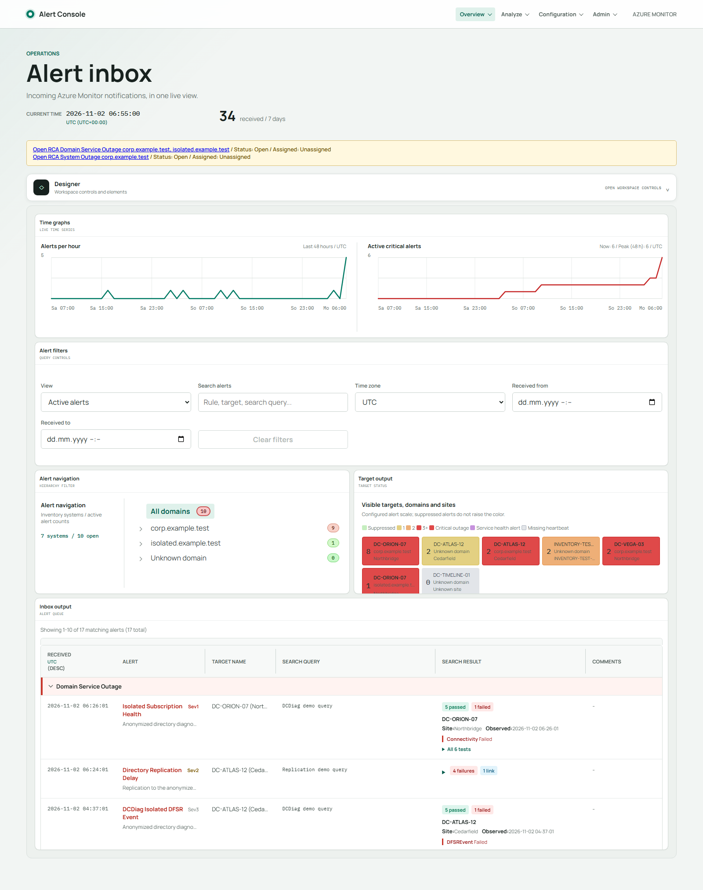

*Screenshots show the current application running locally with existing demonstration data. Empty catalogs and disabled live connections are shown as they are. KQL examples are editor input, not fabricated live results.*

## Jack in // Your first run

The console is an **ASP.NET Core Blazor application on .NET 10**, backed by **SQL Server or Azure SQL**.

1. **Prepare the host and database.** Follow the [installation and development guide](./MonitoringApp/README.md). Configure the database before starting the application; use the documented installation or upgrade procedure for your environment.
2. **Secure the entrance.** Choose SQL authentication or Microsoft Entra ID and assign application roles. Open mode is useful on an isolated demo rig, not a substitute for production access control.
3. **Connect the sensors.** Route Azure Monitor notifications through the documented Logic Apps integration. Configure and verify alert-ingestion authentication separately from interactive sign-in.
4. **Wire up live analysis when needed.** Configure tenant/workspace routing and the required Azure permissions and credentials. Use the Log Analytics administration page to check connectivity before enabling queries or schedules.
5. **Build the crew's workspace.** Maintain inventory, review alert rules, prepare and publish dashboard queries, then assemble personal dashboards.

For source-based local development, after configuration and database setup:

```powershell
dotnet run --project .\MonitoringApp\MonitoringApp.csproj --launch-profile http
```

The local HTTP profile serves the console at `http://localhost:5078`. Published deployments can run under IIS or Azure App Service; see the technical guide for hosting, configuration and diagnostics.

## Find your sector // Navigation

Menus follow your application role and the features enabled on the host.

| Sector | Tools | Use it for |
| --- | --- | --- |
| **Overview** | Inbox, Graph, published Dashboards | Monitor the situation and open shared, read-only cockpits. |
| **Support** | Lockouts | Investigate account lockouts and related failed sign-ins. |
| **Analyze** | Request API, Logbook, Root Cause Analysis, Analysis Workspace, Free KQL query | Inspect events, investigate incidents and query the evidence. |
| **Configuration** | Alert rules, Inventory, Dashboard editor, KQL Dashboard queries, Scheduled KQL alert rules | Maintain the operational toolkit. |
| **Admin** | Settings, Log Analytics, alert authentication, Users | Manage access, connections, languages and application settings. |

## Alert inbox // Separate signal from noise

Start with **Overview > Inbox**. Switch between active alerts and event history, search for a system or rule, and narrow the received-time range. Choose a display time zone without changing the underlying event timestamps.

- Read categorized alerts, severity colors and formatted check results.
- Use the two timelines to compare incoming events with active critical incidents.
- Follow system navigation and target status to understand the affected environment.
- Open alert details, inspect the source payload and record a comment.
- Follow open-RCA notices into the corresponding investigation.

Open **Designer** to arrange the inbox around your workflow. Move and resize its panels, adjust their appearance, save layouts, and use undo/redo while editing. Table-column controls help keep the useful evidence in view.

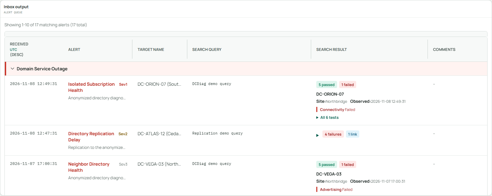

## Graph and inventory // Map the corporate sprawl

**Overview > Graph** connects alerts to the maintained infrastructure. Choose hierarchy layers such as subscription, domain, site, role and target; filter the graph to follow a particular branch. The site map adds geographic context, while status indicators distinguish alerts, maintenance and stale system information.

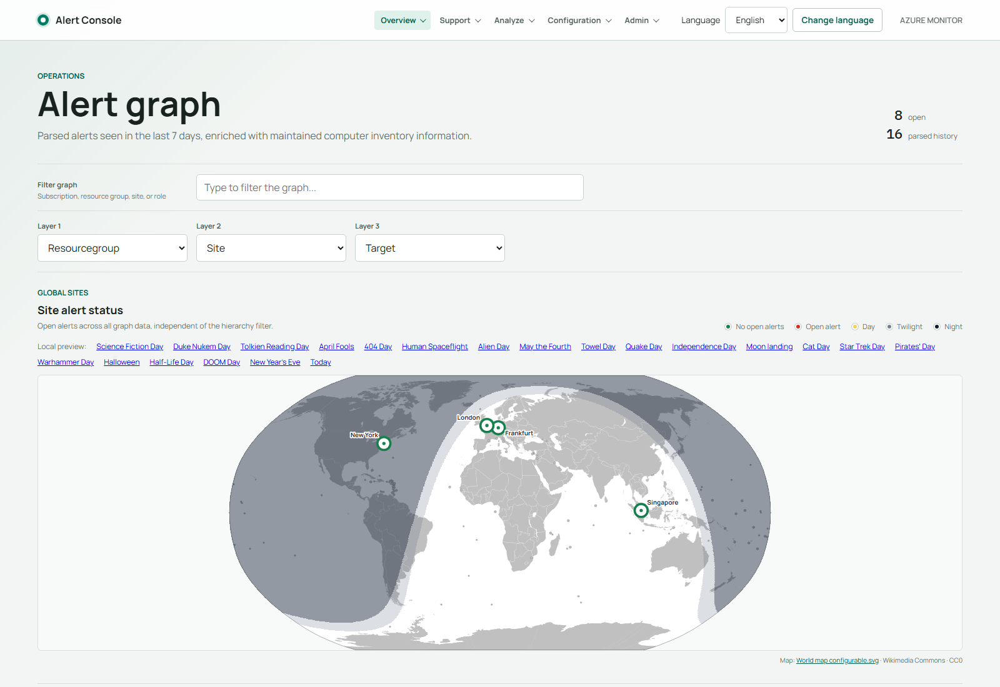

Under **Configuration > Inventory**, search and filter computers, maintain their domain, site and roles, and mark systems for maintenance. Heartbeat, boot and service information provide additional context where available; live heartbeat checks require the corresponding Log Analytics configuration.

When the optional identity directory is enabled, the inventory's team selector filters by the server roles assigned to selected teams. It is an operational filter, **not an authorization boundary**.

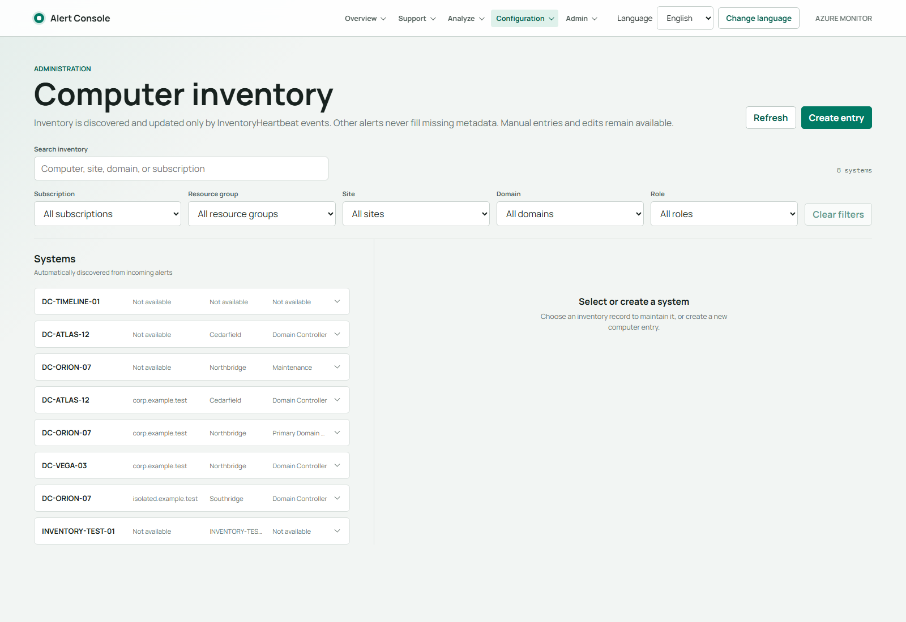

## Dashboards // Build your own cyberdeck

Open **Configuration > Dashboard editor** and enable **Edit** to assemble a personal cockpit.

1. Create or select a dashboard.
2. Choose fixed systems or dynamic inventory-role membership.
3. Narrow the view with workspace, domain, site and role filters.
4. Drag approved queries from the library onto the grid; move and resize the widgets.
5. Set titles, colors, time ranges, averaging intervals and refresh behavior, then save.

Create several dashboards for different duties. Use shared time controls when comparing widgets, or retain each widget's individual settings. Undo/redo supports layout editing.

Available visualizations include **tables, line and bar charts, honeycombs, gauges, metrics and status timelines**. The query's presentation configuration determines which view is available. Widgets report missing data and execution errors rather than dressing them up as a green light.

Dynamic role selection follows current inventory membership. Saved fixed selections remain intact when view filters narrow the display; systems no longer present in inventory are skipped with a visible notice.

**Admins can publish dashboards for the crew.** Operators and admins open published dashboards under **Overview > Dashboards**, including direct menu entries. Published views are read-only; personal edits do not silently remodel the shared cockpit. Duplicate a dashboard when you need your own starting point.

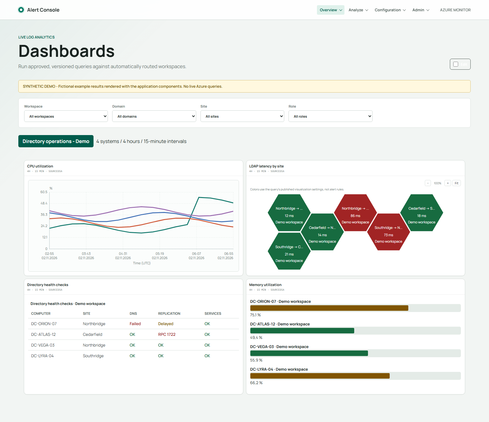

### Take the layout with you // Dashboard setup JSON

In the editor, enable **Edit** and expand **Dashboard setup JSON**.

- **Export:** prepare the current setup, then download its JSON file. The snapshot can include unsaved layout changes.
- **Import:** open a JSON file or paste its contents, check the preview, resolve workspace mappings and review missing systems or roles.
- **Apply:** import as a **new private dashboard**. Existing dashboards and publications are not overwritten.

The setup carries widget positions and sizes, query keys, layout settings, system selection, filters and refresh settings. It references queries already available on the destination: **it does not embed KQL, query visualization definitions, results, credentials or permissions**.

Publish the required queries first. Missing or unavailable query dependencies block import. Import itself does not run queries; review the new dashboard before starting it.

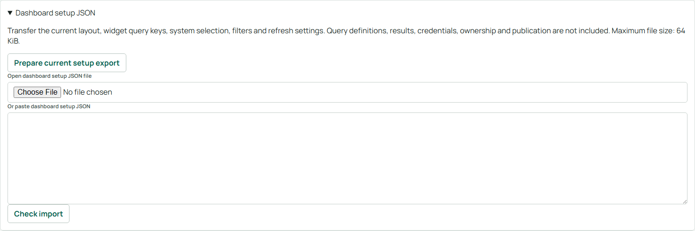

## KQL query library // Keep the arsenal organized

Use **Configuration > KQL Dashboard queries** to create and maintain reusable analysis queries.

- Install the bundled Active Directory templates as a starting point for health, replication, performance and security investigations.
- Organize queries in categories and subcategories; reorder and assign them through the management controls or drag and drop.
- Assign the intended workspaces, configure parameters and presentation, and test the draft.
- Publish a reviewed version for dashboard use. A draft does not replace the version already in service.
- Import JSON query templates or export query definitions and their presentation settings as a ZIP containing JSON files.

This is the content package; dashboard setup JSON is the layout package. Neither is a full application backup.

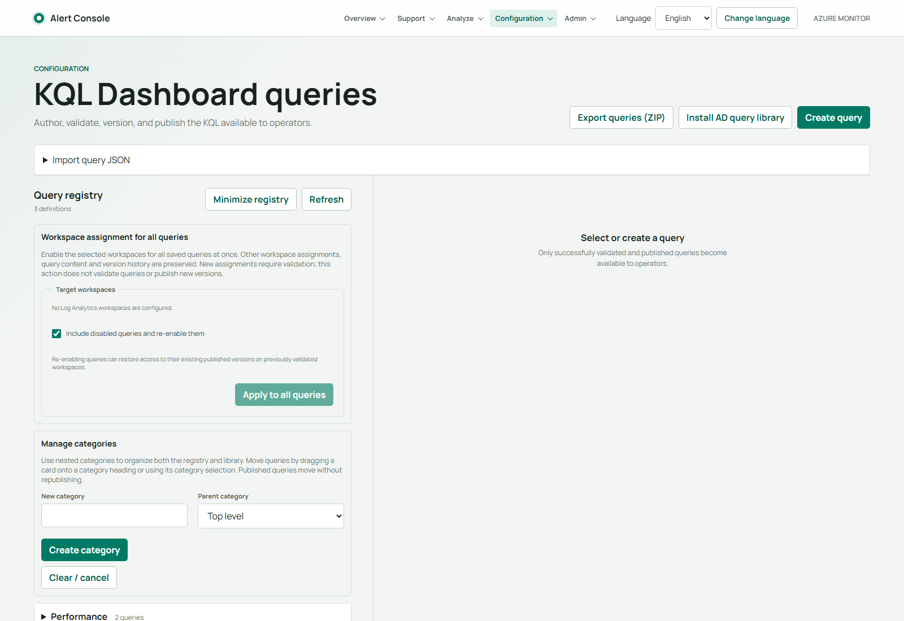

## Free KQL // Work directly on the wire

Open **Analyze > Free KQL query**, select a configured workspace and enter your query. The console sends the KQL **as written**: no hidden system filter, time filter or query wrapper. Include the scope you actually intend, execute deliberately, and inspect the returned tables. Cancel a running request when necessary.

The same editor assistance is available when authoring dashboard queries and scheduled rules:

| Tool | How to use it |
| --- | --- |
| **Grey completion** | When a prefix has one eligible completion, press **Tab** to accept it. **Escape** dismisses it; **Enter** remains a newline. |
| **Context-aware suggestions** | Complete keywords, supported keyword sequences, discovered tables, local bindings and columns where their context is safely known. |
| **Syntax coloring** | Recognized dictionary words are highlighted without changing the underlying text. |
| **Quick help** | Hover a recognized word or press **F1** for a short explanation and syntax template. |
| **Keyword reference** | Open the dropdown, browse the dictionary, and focus or hover an entry for its structured explanation and example. |
| **Local hints** | Review limited bracket and column-reference diagnostics; select a hint to locate the relevant text. |
| **Undo/redo** | Accepted completions participate in the editor's native undo history. |

Table discovery and schema tooltips use the selected workspace's metadata. Their state, errors and reload controls remain visible. Metadata discovery can incur Azure query costs; it is separate from the local keyword dictionary.

The helper is deliberately conservative, **not a complete Kusto parser**. Supported joins, unions and pipelines can preserve known schema context; ambiguous or unsupported constructs are not treated as proven column errors.

Keywords, fixed follow-up sequences and help text live in the [JSON dictionary](./MonitoringApp/wwwroot/js/kql-completion.json), not a hard-coded word list.

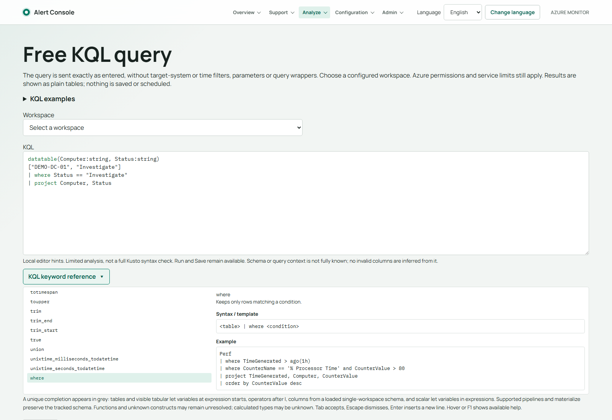

## Alert rules // Put ICE around the noise

Use **Configuration > Alert rules** to classify incoming signals, suppress known noise, highlight critical conditions and maintain inventory-role assignments where the rule calls for it. Review rule conditions and ordering so the crew knows why an event received its classification.

**Configuration > Scheduled KQL alert rules** adds recurring checks:

1. Create a rule or open a JSON template.
2. Select workspaces and the appropriate system-based or workspace-wide scope.
3. Configure the query, evaluation schedule and alert conditions.
4. Test and inspect the preview before enabling the rule.

Templates cover common operational and security investigations, including logon activity, Kerberos, directory/account changes and unknown replication targets. The inventory-target check compares observed replication destinations with known inventory and tracks unknown targets individually.

Measured recovery, missing data and query failure are different states. A failed or incomplete check is not evidence that an incident has cleared.

<details>
<summary>Open the rule consoles</summary>

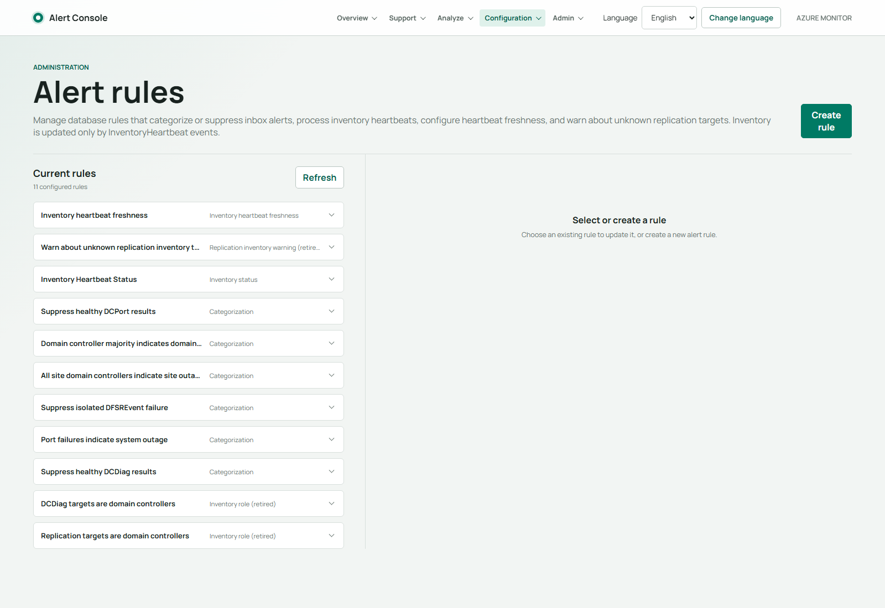

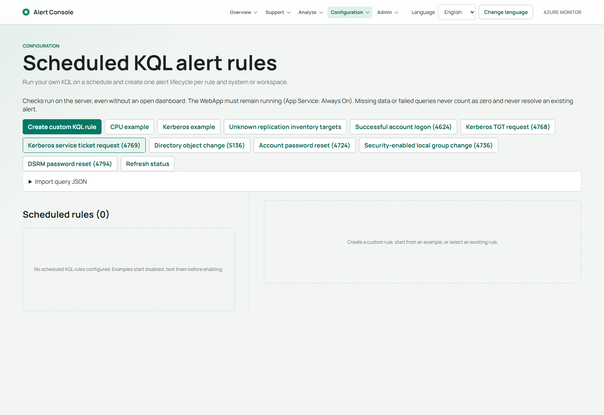

</details>

## Support: Lockouts // Follow the failed handshake

Open **Support > Lockouts**, choose a workspace and time window, then select an account from the discovered lockout users. Search to inspect related failed sign-ins, including protocol, client, address and process information when present.

The tool uses the configured Log Analytics access and does not require an inventory selection or a saved dashboard query. Results depend on the events available in that workspace.

## RCA and logbook // Leave a trail the next shift can follow

**Analyze > Root Cause Analysis** turns related critical signals into shared investigations. Open a case to review linked alerts, evidence, prepared prompt snapshots and its change history.

Authorized admins can create cases, assign alerts, maintain responsibility and status, and record analysis and comments. Alert recovery does not silently close an investigation; the crew controls its conclusion.

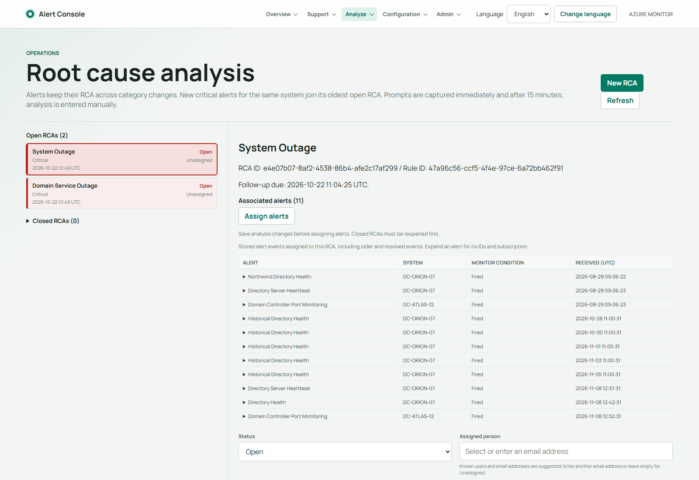

**Analyze > Logbook** is the shared shift memory: add operational notes and review incident transitions and alert-comment activity with their recorded authors and timestamps.

## Analysis Workspace // Keep a human at the controls

Where enabled, **Analyze > Analysis Workspace** prepares investigation context from selected alerts, system history, related events, inventory, graph relationships and rule decisions.

Choose the incident or target scope, inspect the included evidence and review the prepared prompt before a manual Copilot handoff. Configured analysis profiles and execution modes are governed separately; a visible workspace is not permission for unrestricted external execution.

Availability depends on the host's analysis configuration. Disabled execution is shown explicitly. Do not send credentials or confidential telemetry to an external tool without the required approval.

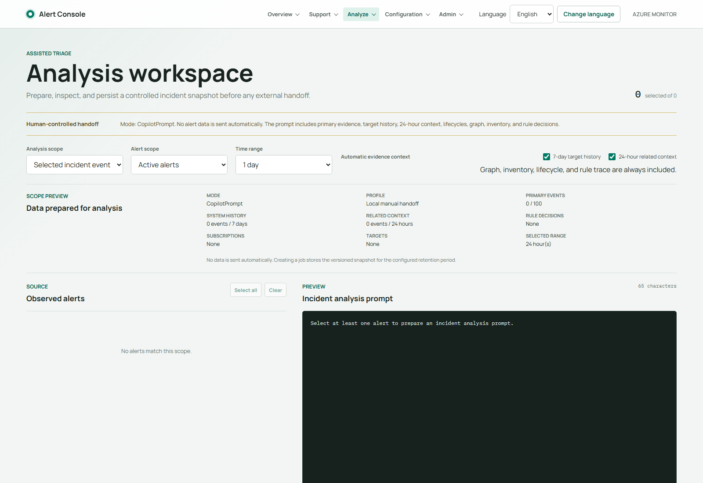

## Access and identities // Wards at the entrance

| Role | Operational remit |
| --- | --- |
| **Reader** | Read the monitoring views, available investigations and logbook; use the permitted observation and support tools. |
| **Operator** | Also maintain inventory and alert rules, run free KQL, edit personal dashboards, and manage dashboard queries and schedules. |
| **Admin** | Also manage users and settings, publish dashboards and maintain RCA investigations. |

SQL accounts and Microsoft Entra ID support controlled application access. Ingestion authentication is a separate concern: opening the web console does not configure the sensor endpoint's credentials.

When enabled, the identity directory adds user profiles, teams and optional SCIM provisioning. Admins can maintain historical display profiles and group legacy identifiers as aliases. Display aliases are **not merged sign-ins or extra application roles**; the designated main identity can work with associated legacy dashboard collections only within the existing access rules.

Use **Admin > Users** for the applicable account and directory controls. Keep the distinction between an attractive display name, a verified identity and an actual permission.

## Languages and settings // Change the interface, not the build

Choose an available language in the header and apply it. The browser remembers the choice, and the language-switch dialog warns before discarding unsaved inputs.

Under **Admin > Settings > Languages**, administrators can:

1. Add language cultures, choose display names and map them to JSON files.
2. Upload translation packages and choose which languages are selectable.
3. Set the default for visitors without a valid language choice.
4. Check a draft and inspect its validation report before confirming activation.
5. Download the registry or active packages, and preview a previous configuration before restoring it.

Language packages and the registry are external JSON files. Valid changes take effect after a **full page reload, without recompilation or an application restart**. Existing sessions retain their text snapshot until reloaded.

English remains the complete fallback package. Missing translations in another language use English; adding a culture does not automatically translate the interface, stored content, KQL help or prompts. Invalid updates retain the last validated text set and surface a warning.

These controls are independent of the database-backed startup settings below them. Those settings display their own restart requirement. Preserve runtime language files across deployments, grant write access only to their controlled directory, and coordinate language storage across multiple application instances.

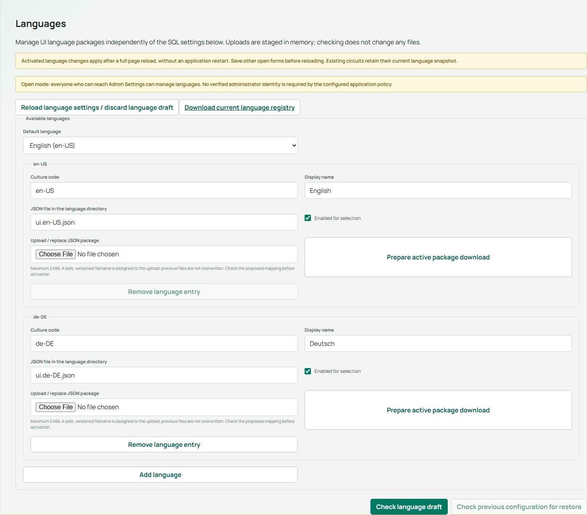

## Connect the rest of the crew // APIs and companion tools

- **Request API:** open **Analyze > Request API** for examples of reading current alerts and event history. Use the authentication required by your deployment.
- **Alert ingestion:** Azure Monitor and Logic Apps feed the alert endpoint; administration provides separate ingestion-authentication guidance and diagnostics.
- **Cross-tenant Log Analytics:** route approved analysis to the configured workspaces and credentials rather than maintaining a separate console for every tenant.
- **CLI:** the [Alert Console CLI](./AlertConsoleCli/README.md) reads active alerts or a bounded history window and writes JSON for scripts.
- **Web Agent POC:** the optional [browser-based worker](./AlertWebAgent/README.md) watches alert events and can forward notifications to a configured Teams workflow. Treat it as a separately configured proof of concept, not an autonomous incident responder.
- **Application monitoring:** optional Azure Monitor/OpenTelemetry integration supports monitoring the console itself.

## Before the next run // Field manuals

Keep the overview here and the deployment-specific detail in the field manuals:

- [Installation, local development and operations](./MonitoringApp/README.md)
- [Authentication setup](./MonitoringApp/doc/AUTHENTICATION-SETUP.md)
- [Multi-tenant monitoring](./MonitoringApp/doc/MonitoringMultiTenantOptionA.md)
- [Logic Apps integration and templates](./MonitoringApp/doc/LogicApps/README.md)
- [Identity directory, users, teams and SCIM](./doc/SCIM-PROJEKTPLAN.md)
- [Optional local demonstration data](./MonitoringApp/DemoData/README.md)
- [Browser tests and screenshot regeneration](./PlaywrightDemo/README.md)
- [Third-party components and licenses](./doc/THIRD-PARTY-DEPENDENCIES.md)

Protect secrets, back up the database and runtime configuration, verify permissions, and test live queries before putting them on a schedule. An exported dashboard is a travel kit, not a disaster-recovery plan.

**Keep the signal clean, the evidence intact, and the crew out of the dark.**
